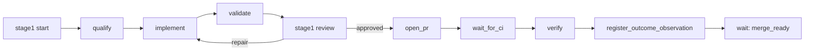

# Operator Guide

This is the operator-facing reference for running Enginery locally: install,
configuration, health checks, the Stage 1 command surface, recovery,
backup/restore, and the security limits an operator must understand before
running real workflows.

Every command shown here is copied from `--help` output or a real, executed
invocation against this repository at the version documented in
[`README.md`](../README.md#status). Enginery is `v0.5.0`. The Stage 1
(issue-to-merge-ready-pull-request) and Stage 2 (plan to verified
release) command surfaces are supported, documented features of this
release; `stage2 status` remains the only Stage 2 CLI command (a
read-only stack inspection — Stage 2's own merge/build/publish
orchestration runs through the release-preparation workflow, not a
shipped `enginery` verb). Stage 3 (incident to hotfix and rollback) is
a shipped, adversarially-tested library surface
(`enginery.incidents`) with no CLI command of its own yet — see
[`docs/adapters.md`](adapters.md#the-incident-to-hotfix-and-rollback-surface).
Stage 4 (governed factory self-improvement) has no CLI surface and is
gate-deferred — see
[Release scope and gate-deferred work](#release-scope-and-gate-deferred-work).

## Installation

`v0.1.0`, `v0.2.0`, `v0.3.0`, `v0.4.0`, and `v0.5.0` are published to PyPI
and GitHub Releases; `v0.5.0` (2026-08-11) is the current release. Install
the published package with:

```bash
pip install enginery
```

Or install from source:

```bash
git clone https://github.com/Mathews-Tom/Enginery.git
cd Enginery
uv sync --all-extras --dev
```

This requires [`uv`](https://docs.astral.sh/uv/) and Python 3.12 or newer.
Enginery is Apache-2.0 licensed and supports macOS and Linux. **Windows is
not supported in this release.** The approved local-supervisor design binds
process supervision, cancellation, and recovery to POSIX process groups,
signals, and process-start identity; native Windows process supervision and
worktree locking are out of scope until a Windows-specific supervisor
backend is designed and proven.

After installing, run the built-in health check before doing anything else:

```bash
uv run enginery doctor
```

```text
[ok] python_version: running Python 3.12.8; requires >= 3.12
[ok] package_metadata: enginery 0.5.0 installed
```

`enginery doctor --json` emits the same report as a machine-readable
document; every CLI command that reports structured state accepts `--json`
for scripting.

## Configuration

Enginery does not read a project- or user-level configuration file in this
release. Every run's provider configuration is an explicit, versioned
`--request` document passed to `enginery stage1 start` (see
[Running a Stage 1 workflow](#running-a-stage-1-workflow) below): work-item
identity, acceptance criteria, validation commands, and an
`execution_configuration` block naming the GitHub repository, an opaque
GitHub credential reference, the harness provider (`omp` or `claude-code`),
an opaque harness credential reference, and an absolute artifact root. A
credential *reference* is not a credential: the GitHub CLI (`gh`) and the
configured harness CLI (`omp` or `claude`) each resolve their own
already-authenticated local session; Enginery never reads, stores, or
serializes a literal secret value.

The request also carries an `execution_selection` block: the harness a run
requested and, optionally, a model and a native effort, each recorded with
the layer that supplied it, together with the digest of the packaged
execution-control catalog it was resolved against. `build-request` binds the
host's own default model and effort unless `--model` or `--effort` is given (see
[Execution selection and receipts](#execution-selection-and-receipts)); `--strict-effective`
only modifies a pinned model and never changes what is bound. A request document is validated against the packaged catalog when a run
starts, so an alias, an unpinnable effort, a different tested host version or
a support tier the catalog does not assign is rejected. A run persisted
before this block existed keeps its original request digest, decodes
unchanged, and runs as a host default with unknown effective controls;
Enginery never invents a selection for it. If the packaged catalog differs
from the one a run was bound to (for example after upgrading Enginery),
`enginery stage1 watch` reports the diagnostic as `hold` and refuses to
advance the run; the run's original binding is retained, never rebound.

The layered repository/user/workflow-profile TOML configuration model
described in the system design is a forward design target for a later
milestone, not present-state behavior. Do not write a `.toml` configuration
file expecting Enginery to read it today.

The `--database` flag on every mutating command names the SQLite ledger
file. There is no default location; an operator chooses and tracks this
path per project or environment. The ledger file is the single source of
durable truth: deleting or corrupting it discards every run, node, policy
decision, and evidence record it contains, so back it up (see
[Backup and restore](#backup-and-restore)) before any risky operation.

## Command surface

The full current CLI surface, generated from `enginery --help`:

```text
usage: enginery [-h] [--version]
                {doctor,adapter,ledger,policy,stage1,stage2,outcome,gate,workspace,capability}
                ...

positional arguments:
  {doctor,adapter,ledger,policy,stage1,stage2,outcome,gate,workspace,capability}
    doctor              Report locally implemented prerequisites.
    adapter             Inspect configured adapter providers.
    ledger              Ledger consistency and storage commands.
    policy              Explain policy decisions.
    stage1              Run the Stage 1 issue-to-PR lifecycle.
    stage2              Inspect Stage 2 plan-to-release stack state.
    outcome             Inspect raw outcome observations and completeness.
    gate                Report readiness against a decision gate.
    workspace           Inspect and release run-scoped workspace reservations.
    capability          Capability lock commands.
```

This is materially narrower than the full command-family list in the system
design document, which also names `init`, `work`, `run`, `evidence`,
`workflow`, `factory-change`, and `gc` families. Those are design targets
for later milestones; they do not exist in this release. Do not document or
script against a command that is not listed above.

| Command | Purpose |
|---|---|
| `enginery doctor [--json]` | Report locally implemented prerequisites (Python version, installed package). |
| `enginery adapter doctor [--json] [--github-repository ...] [--deployment-app-script PATH] ...` | Report the deterministic local provider and Stage 2/3 broker configuration state Enginery ships (see [Local provider inventory and Stage 2/3 broker configuration](#local-provider-inventory-and-stage-23-broker-configuration)). |
| `enginery ledger verify --database PATH [--artifacts PATH] [--json]` | Check ledger and artifact-store consistency. |
| `enginery ledger backup --database PATH --output PATH [--artifacts PATH]` | Snapshot a ledger to a directory. |
| `enginery ledger restore --backup PATH --database PATH [--artifacts PATH]` | Restore a ledger from a backup directory. |
| `enginery ledger rebuild-projections --database PATH` | Rebuild ledger projections from stored events. |
| `enginery policy explain REQUEST [--json]` | Explain a policy decision for a request document without authorizing it. |
| `enginery stage1 {start,watch,review,approve,reject,cancel,resume,evidence,build-request}` | Run and inspect the Stage 1 lifecycle, plus compose a `--request` document from flags (below). |
| `enginery stage2 status --database PATH --owner OWNER --stack-id ID` | Report one Stage 2 stack's slice states and merge readiness. |
| `enginery outcome {list,show,completeness,interventions,failures}` | Inspect raw outcome observations and completeness. |
| `enginery gate status --gate G4 --database PATH [--floor-config PATH] [--json]` | Report fail-closed G4 readiness from classified completed runs and recorded authority evidence. |
| `enginery gate record-g4-deficiency --database PATH --finding-id ID --deficiency TEXT --cited-run-id RUN_ID ... --evidence-pull-request-number N --producer-principal-id ID --evidence-pull-request-author-login LOGIN --correlation-id ID [--floor-config PATH] [--json]` | Record an immutable recurring-deficiency finding against a verified classified cohort and derive its evidence-PR document digest. |
| `enginery gate record-g4-deficiency-evidence --database PATH --finding-id ID --correlation-id ID --github-repository OWNER/REPO --github-credential-reference REF [--github-executable PATH] [--floor-config PATH] [--json]` | Verify one merged GitHub evidence PR and record its immutable two-human authority evidence. |
| `enginery workspace inspect --database PATH --owner OWNER [--json]` | List every repository's current workspace reservation. |
| `enginery workspace release --database PATH --owner OWNER --repository-id ID --run-id ID [--dry-run] [--json]` | Release a retained workspace reservation with no live lease (below). |
| `enginery capability lock [--check] [--lockfile PATH] [--capabilities-root PATH] [--json]` | Inspect or verify a capability lock. |

### Gate G4 operational evidence

G4 is a measurement gate, not a self-improvement capability. A failing or unmeasured status blocks the later self-improvement work; it never creates a pass through a local flag, manually edited ledger row, or a command transcript.

#### Classify a source work item

For every GitHub source item intended for the classified cohort, apply exactly these two labels, with matching lowercase spelling:

```text
enginery/work-kind/issue | enginery/work-kind/plan
enginery/risk/low | enginery/risk/medium
```

Enginery rejects an absent, unknown, conflicting, duplicate, or case-variant label. It never infers a kind or risk. The source adapter reads the issue and all label pages twice; a source or classification change during that read rejects the snapshot. The serialized request retains the canonical labels, source URL, source revision, and source-bound digest. Legacy or manually constructed requests without this provenance are excluded from classified G4 cohort counts.

Only low-risk `issue` and `plan` work is eligible for direct Stage 1 implementation. Medium-risk classified work remains human-approval-gated. High risk and every other kind are rejected rather than rerouted.

#### Register current authority principals

Use the schema-2 `registered_principals.identities` list in the G4 floor configuration. Each row binds one stable principal ID to one immutable GitHub numeric user ID. A login is retained only as a human-readable diagnostic:

```toml
schema_version = 2

[registered_principals]
identities = [
  { id = "operator-a", github_user_id = 101, github_login = "operator-a-login" },
  { id = "operator-b", github_user_id = 102, github_login = "operator-b-login" },
]
```

Principal IDs and GitHub numeric user IDs must be unique. GitHub logins are also unique case-insensitively, but are never used to authenticate authority. Schema-1 `registered_principals.ids` configuration and any schema-2 row without `github_user_id` are deliberately unsupported. Migrate each opaque ID to a verified GitHub numeric identity; preserve the login only for diagnostics. Do not change the roster to reinterpret a recorded authority decision.

#### Record a recurring-deficiency evidence PR

First record the recurring deficiency. The command rejects any cited run not in the current verified classified cohort:

```bash
uv run enginery gate record-g4-deficiency \
  --database ledger.db \
  --finding-id recurring-validation-failure \
  --deficiency "Validation fails after generated dependency update" \
  --cited-run-id run-001 \
  --cited-run-id run-002 \
  --evidence-pull-request-number 42 \
  --producer-principal-id operator-a \
  --evidence-pull-request-author-login evidence-author-login \
  --correlation-id record-g4-finding-2026q3
```

The command derives a canonical evidence document and digest from the immutable finding: its ID, deficiency, and cited run IDs. Open and merge an evidence PR whose exact UTF-8 body is that canonical document, not a filename or local draft. Its author must not be the finding producer. Two distinct configured humans, neither the author nor producer, must have their current review state `APPROVED` on the exact merged PR head. The verifier binds the PR author and every reviewer to GitHub's numeric `user.id`, not their mutable login; re-review after a push because a stale approval is insufficient.

Run the live verifier only after the PR is merged:

```bash
uv run enginery gate record-g4-deficiency-evidence \
  --database ledger.db \
  --finding-id recurring-validation-failure \
  --correlation-id record-g4-authority-evidence-2026q3 \
  --github-repository OWNER/REPO \
  --github-credential-reference operator-gh-cli \
  --json
```

The command reads the GitHub pull request and every review page. GitHub authentication, API, malformed-payload, missing or non-numeric `user.id`, unmerged-PR, document-digest, stale-head, author/producer, and approver failures stop the command without recording authority evidence. A successful record is immutable; use a new deficiency finding when any cited evidence changes.

#### Inspect status

```bash
uv run enginery gate status --gate G4 --database ledger.db --json
```

The `recurring_evidence_backed_deficiency` condition remains `unmeasured` until a finding cites eligible classified completed runs and an immutable authority record matches its PR number and evidence digest with two principals still in the configured roster. Other G4 conditions remain independent. A passing single condition does not make G4 pass; every reported condition must pass.

### Local provider inventory and Stage 2/3 broker configuration

`enginery adapter doctor --json` reports the deterministic local providers
Enginery ships out of the box — these back local development and the
cumulative Stage-1 gate described in
[Cumulative Stage-1 recovery evidence](#cumulative-stage-1-recovery-evidence),
not a live GitHub/OMP run — plus the real Stage 2 release brokers
(`GitHubReleaseAdapter`, `PyPiAdapter`) and the real Stage 3
`LocalServiceDeploymentAdapter`. Every broker entry is a local
configuration-sanity check only — is the required CLI tool installed
(`gh --version`, `uv --version`), does the deployment fixture's
`app_script` exist, does its `python_executable` resolve — never a
live GitHub, PyPI, or local-service network call:

```text
$ enginery adapter doctor --json
[
  {"kind": "work_ledger",       "provider_id": "local-work-ledger",       "capabilities": ["fetch", "publish"]},
  {"kind": "harness",           "provider_id": "scripted-harness",        "capabilities": ["cancel", "events"]},
  {"kind": "workspace",         "provider_id": "local-git-worktree",      "capabilities": ["create", "cleanup", "retain"]},
  {"kind": "source_control",    "provider_id": "local-git",               "capabilities": ["branches", "commits", "diff"]},
  {"kind": "validation",        "provider_id": "local-validation",        "capabilities": ["commands"]},
  {"kind": "release",           "provider_id": "local-publication",       "capabilities": ["publish", "verify"]},
  {"kind": "deployment",        "provider_id": "local-deployment-fixture","capabilities": ["deploy", "rollback"]},
  {"kind": "capability_source", "provider_id": "local-capability-source", "capabilities": ["discover", "resolve"]},
  {"kind": "release",           "provider_id": "github-release",         "capabilities": ["release_create_and_verify"]},
  {"kind": "release",           "provider_id": "pypi",                   "capabilities": ["publish_and_verify"]},
  {"kind": "deployment",        "provider_id": "local-service-deployment","capabilities": ["deploy", "observe", "rollback"]}
]
```

`github-release` and `pypi` bind to the GitHub repository and PyPI
project name an installed `enginery` distribution's own package
metadata reports (`Project-URL: Repository`, `Name`) — the same source
`scripts/verify_project_identity.py` treats as canonical — never a
fabricated placeholder; `--github-repository`/`--pypi-project-name`
override them, and `--github-executable`/`--pypi-executable` override
the CLI tool checked (default `gh`/`uv`). `local-service-deployment`
checks `--deployment-app-script` (default
`fixtures/enginery-stage3-local-service/app.py`, relative to the
current directory), `--deployment-artifacts-root`/
`--deployment-state-root` (default under `.enginery/`), and
`--deployment-python-executable` (default the running interpreter). A
missing prerequisite reports `"availability": "misconfigured"` or
`"unavailable"` with a `detail` string, never a silent pass, and
`adapter doctor` exits non-zero — the same fail-closed convention
`doctor`/`gate status` already use.

Each entry also carries a content-addressed `fingerprint`; a Stage 1 run
binds to the exact fingerprint of every provider it uses and refuses to
silently resume under a changed adapter (see
[Recovery semantics](#recovery-semantics)).

## Running a Stage 1 workflow

Stage 1 takes one issue-shaped work item from qualification through an
open, current-head-CI-verified, `merge_ready` pull request. It never
merges — merging is a separately policy-gated Stage 2 action.



### Composing a request

`stage1 start --request` needs a JSON document decodable by
`stage1_request_from_state`. `enginery stage1 build-request` writes one
from flags instead of hand-writing the Python composition
[`docs/examples.md`](examples.md#example-b-real-github-issue-with-an-omp-or-claude-code-harness)
documents:

```bash
uv run enginery stage1 build-request \
  --output request.json \
  --run-id issue-142 \
  --repository <owner>/<repo> \
  --external-reference "https://github.com/<owner>/<repo>/issues/142" \
  --source-snapshot-reference "issue:142@<observed-revision>" \
  --source-revision <observed-revision> \
  --base-revision <real base revision> \
  --title "<issue title>" \
  --objective "<what a merge-ready PR must accomplish>" \
  --acceptance-criterion "<criterion 1>" --acceptance-criterion "<criterion 2>" \
  --repository-path <absolute path to the local checkout> \
  --workspace-path <absolute path to a fresh workspace directory> \
  --artifact-root <absolute path to an artifact directory>
```

Every field not shown above defaults to the same values
`docs/examples.md` documents (`policy-v1`, `uv run pytest -q`,
`repair-limit 1`, a 1800-second/`5.0`-cost-budget OMP implementation
attempt, `operator-gh-cli`/`operator-harness-session` credential
references). `--capability-lockfile` (default
`.enginery/capabilities.lock.json`) binds the request's
`capability_lock_digest` to the real lockfile `enginery capability
lock` already reads when one exists, and to the documented
no-capabilities-locked sentinel otherwise.
`--environment-manifest-digest`/`--environment-manifest-file` and
`--configuration-snapshot-digest`/`--configuration-snapshot-file`
bind the two remaining opaque `Run` digests to real bytes when a real
environment manifest or configuration snapshot exists; omitted, they
fall back to the same fixed local-environment/local-configuration
sentinels the documented manual script uses. The command never
contacts GitHub, OMP, or any external provider — it only writes a
local file.

A new `stage1 start` accepts only a request whose manifest binds the current check
contracts. Requests written by `v0.5.0`'s `stage1 build-request` (manifest schema 1)
are rejected at start and must be rebuilt with the current `enginery stage1 build-request`.
A run already started from such a request is read and resumed unchanged. A validation
command that launches a shell interpreter is also rejected at start.

Every step after `stage1 start` runs through `enginery stage1 watch
--advance`, which performs **at most one durable next action** derived
purely from the ledger and returns the next action still pending:

```bash
uv run enginery stage1 start --database ledger.db --owner operator --request request.json
uv run enginery stage1 watch --database ledger.db --owner operator --run-id run-1 --advance
# repeat `watch --advance` until `next_action` reports `wait`
uv run enginery stage1 review --database ledger.db --owner operator --run-id run-1 \
  --report review.json --repair-attempt 0
uv run enginery stage1 evidence --database ledger.db --owner operator --run-id run-1
```

`stage1 review` is a separate command because it records an independent
human or reviewer decision `watch --advance` cannot manufacture on its own.
`stage1 approve` / `stage1 reject` resolve a node the run is durably waiting
on a human decision for; `stage1 cancel` terminates a running or
human-waiting node; `stage1 resume` restarts a specific human-wait node
after a durable interruption. `stage1 evidence` prints the run's current
status, request digest, source revision, every runtime node's state, and an
`execution` block (see [Execution selection and receipts](#execution-selection-and-receipts))
— the operator's read path for "what is this run doing and why."

### Execution selection and receipts

`stage1 build-request` accepts three optional flags that pin the run's execution
controls at the run layer:

- `--model` pins an exact model. For `omp` it must be provider-qualified
  (`provider/id`); for `claude-code` it must be a full model name, not an alias
  such as `opus` or `sonnet`.
- `--effort` pins the harness's own native effort level (`omp`: `off`, `minimal`,
  `low`, `medium`, `high`, `xhigh`, `max`; `claude-code`: `low`, `medium`, `high`,
  `xhigh`, `max`). The vocabularies are not mapped onto each other, and OMP's
  `auto` cannot be pinned because it hands the choice to the host.
- `--strict-effective` is a modifier for `--model`, not a pin: it requires `--model`
  and holds the run unless the host reports exactly the pinned model. Neither host
  reports the effective effort, so `build-request` rejects it together with `--effort`
  (exit code 2, no file written, and the same check applies when a run starts) rather
  than spend a worker session on a run that cannot pass.

Unsupported pins are rejected by `build-request` itself, with exit code 2 and
before any file is written. Omitted flags leave the host's own default, which is
shown as `host default`, never as a level. Pins are exact: there is no fuzzy
matching, no fallback model, and no retry with a different model or effort after a
failure.

`stage1 watch` and `stage1 evidence` print an `execution` block that keeps four
things apart: `requested` (the value and the layer that supplied it), `selected`,
`submitted` (the control arguments extracted from the command that was actually
launched, once the implementation has run) and `effective` (the model the host
reported, or `unknown` with the reason; the effective effort is always `unknown`
today). It also carries the support tier (both hosts are `experimental`), the
catalog version and digest, the host version and protocol fingerprint the controls
were tested against, and any `holds`. The same hold is also printed as the
top-level `hold`. Only the host's executable version is probed (a read-only
diagnostic creates no files); its protocol is the one the adapter declares. A
matching fingerprint or a captured launch request does not raise a host above
`experimental`.

A held run is not advanced, and its original binding is never rewritten. Recovery
depends on the reason, and `stage1 resume` does not clear a hold:

| Hold reason | Cause | Recovery |
|---|---|---|
| `catalog_drift` | The packaged catalog no longer matches the one the run was bound to (for example after upgrading Enginery). It holds unpinned host-default runs too, not only pinned ones. | Restore the Enginery version (catalog) the run was bound to and re-run `stage1 watch`, or start a new run from a rebuilt request. |
| `host_fingerprint_drift` | A run that pinned a native control, and the installed host is not the tested version, or cannot be probed. | Restore the tested host version and re-run `watch`, or rebuild the request. |
| `effective_control_unverified`, `effective_control_mismatch` | A strict requirement was not met after the worker ran: the effective model was unknown, differed, or the host reported more than one. | Permanent for that run: its implementation attempt is failed. Rebuild the request. |
| `submitted_controls_mismatch` | The launched command did not carry exactly the selected controls (a missing pin or an extra flag such as `--fallback-model`). | Permanent for that run. Rebuild the request. |
| `worker_identity_unprovable` | A running implementation's worker cannot be proven alive or dead from this host: its record is from another machine, or its identity is unreadable. (A reused pid or a reboot proves the worker gone and is reconciled instead.) | There is no supported release for it in this release: the node keeps its slot. Deal with the worker where it was launched; `stage1 cancel` refuses without signalling (see [Queued work, wakeups and worker recovery](#queued-work-wakeups-and-worker-recovery)). |

## Recovery semantics

Enginery permits **one active coordinator per SQLite ledger**. There is no
separate "recovery mode": restarting the `enginery` process and re-running
`stage1 watch --advance` against the same `--database` file *is* recovery.
The ledger, not any in-memory state, is authoritative. Every coordinator
epoch and node lease carries a fencing token; a stale process's write is
rejected even if it is still technically running. If the prior process
cannot be proven dead and its workspace quiescent, Enginery refuses
automatic resumption rather than risk a duplicate side effect (opening a
second pull request, re-running a completed check, and so on).

This protects against **accidental** orphan continuation. It is not hostile-
process containment: git worktrees isolate concurrent runs from each other,
not a compromised or malicious process from the operator's account,
filesystem, network, or keychain. See
[Security limits](#security-limits) below.

### Inspecting and releasing a stuck workspace reservation

A run's `implement` node reserves one workspace per repository for the
run's lifetime. If a run is aborted outside the normal lifecycle (the
process was killed, or a human decides not to continue), that
reservation can outlive the run. `enginery workspace inspect` lists
every repository's current reservation, from the same durable state
`stage1`'s coordinator already reads:

```bash
uv run enginery workspace inspect --database ledger.db --owner operator --json
```

`enginery workspace release` releases one reservation through
`CoordinatorRuntime.release_workspace` -- the identical fenced-proof
check the coordinator already enforces internally, not a weaker
CLI-only check: it refuses unless the reservation belongs to the given
`--run-id` and its status is `retained` (a human-wait or otherwise
quiesced workspace with no live worker lease). A `materialized`
workspace -- one a live worker still holds -- is always refused.
`--dry-run` reports whether release would succeed, and why not when it
would not, without releasing anything:

```bash
uv run enginery workspace release --database ledger.db --owner operator \
  --repository-id owner/repo --run-id run-1 --dry-run
# review the dry-run output, then, only once satisfied, drop --dry-run
uv run enginery workspace release --database ledger.db --owner operator \
  --repository-id owner/repo --run-id run-1
```

**This command is destructive** -- it removes the reserved git
worktree. Always run `--dry-run` first and review its output before
running the real release, especially in an unattended or scripted
context.

### Queued work, wakeups and worker recovery

`stage1`'s scheduler enforces one global concurrency slot and one
per-repository slot by default (matching every documented `stage1`
invocation above). When the `implement` node is registered while
another run holds the slot, it is a durable, visible `queued` state,
not an error.

**What `stage1 watch` shows.** The run's `next_action` is
`dispatch_queued`, the `implement` node's `status` is `queued`, and its
`wakeup` record says why it is waiting:

| `wakeup` field | Meaning |
| --- | --- |
| `reason` | `global_capacity`, `repository_capacity`, `dependencies`, `dependency_failed`, `requirements`, `capacity_reserved_for_other_run`, or `execution_hold` |
| `reserved_for` | the run that holds the reservation when `reason` is `capacity_reserved_for_other_run`, otherwise `null` |
| `queued_since` | when the node entered the queue (set when it was registered); the oldest value is granted capacity first |
| `evaluations` | how many times a coordinator evaluated it |
| `last_evaluated_epoch`, `last_evaluated_at` | the coordinator epoch and time of the latest evaluation |

Once the node is dispatched, `reason` becomes `null` and the record
gains `dispatched_at` and `dispatched_epoch`. The record lives on the
durable runtime node, so any coordinator process reads the same
answer after a restart.

**How redispatch happens, and its bound.** There is no daemon or
timer. Readiness is re-derived from the ledger on every
`stage1 watch --advance`: the first advance of a queued node's own run
after its capacity or dependency is released dispatches that same
operation exactly once (same operation identity, no second lease or
worker). Capacity is granted by one fair plan over every run on the
ledger: oldest queued first, by the durable `queued_since` time kept on
each runtime node, with run id as the tie-break. The order comes only
from persisted state, so every CLI invocation derives the same one and
a later-arriving run never overtakes an older queued run, whatever its
run id. A freed slot therefore goes to the oldest queued run rather than
to whichever run
advances first. Each command launches only its own run's node, behind
that run's own binding checks. A slot granted to another run stays
reserved for it: the waiting run shows
`capacity_reserved_for_other_run` and the `reserved_for` run id. With
no daemon, a fair winner that is never advanced keeps its reservation;
recovery is to run `stage1 watch --advance` on that run, or cancel its
node so the reservation is released.

**Holds.** A run whose execution catalog binding has drifted has
`next_action` `hold`, and its queued node is never dispatched. Because
a held run could otherwise be the oldest fair winner and keep a slot
reserved that no command may use, queued nodes of runs held for catalog
drift are left out of the fair plan: another run can take the slot, and
the held node records `reason: execution_hold` with the hold message in
`detail`, not a reservation, only when another run's tick evaluates
it. This is decided from the ledger's durable
run requests and the current catalog alone. A host-fingerprint hold
(`host_fingerprint_drift`) needs a probe of the installed host and is
not applied to other runs' planning, so a run held that way and queued
as the oldest winner still keeps its reservation until the host is
restored or the node is cancelled. That is a remaining manual case.

**Worker liveness.** For a `running` node, `watch` and `evidence`
report a `worker` object built from the persisted identity: `pid`,
`process_group_id`, `start_identity`, `host` (`machine_id`, `boot_id`
and the display-only `hostname`), `identity_version`, `attempt_id`, the
lease epoch, the current coordinator epoch and `lease_epoch_active`.
`lease_epoch_active` is true only while the coordinator epoch that
launched the worker (the epoch of its lease) is still active; a newer
coordinator owning the ledger does not make it true. `liveness` is:

- `alive`: the exact process (same start identity) still holds its pid
  on this host and boot. With `lease_epoch_active: false` the worker is
  running but the coordinator that launched it has lapsed.
- `exited`: the pid is gone. This is worker death, independent of the
  coordinator heartbeat.
- `pid_reused`: the pid now belongs to a different process on this host
  and boot, including one owned by another user that this user cannot
  signal. The worker is gone, but the pid is not its own: it is
  reconciled automatically and never terminated.
- `rebooted`: the record has this machine's id but an earlier boot id,
  so the worker cannot have survived. It is reconciled as
  `worker_lost_to_reboot` and never signalled.
- `foreign_host`: the record was written on another machine.
- `unverifiable`: the record has no usable identity (for example a
  launch that never recorded one, or an unknown identity version), or
  this host's own identity could not be read.

The host is identified by a stable machine id and boot id, never by
hostname: on macOS the platform UUID (`IOPlatformUUID`) and
`kern.bootsessionuuid` (falling back to the numeric `sec.usec` of
`kern.boottime`, never its time-zone formatted text); on Linux
`/etc/machine-id` (or `/var/lib/dbus/machine-id`) and
`/proc/sys/kernel/random/boot_id`. Renaming the machine or changing the
time zone does not change the identity, and an id that cannot be read
fails closed rather than being guessed. Records written before host
binding carry no host or version; they decode unchanged and are judged
under single-host semantics, as they always were.

The worker's start time is read under a fixed time zone and locale
(`TZ=UTC0`, `LC_ALL=C`), so launching, watching and cancelling from
shells with different `TZ` or `LANG` agree on whether the same worker is
alive. Records written before host binding keep the comparison they
were written with.

**When a worker dies.** If a `running` implementation has no result
file and its worker is gone (`exited`, `pid_reused` or `rebooted`),
the next `stage1 watch --advance` (`next_action: reconcile_worker`)
looks once more for a result, then records the exit, reconciles it
through the recovery path and records the node as `failed` with
`failure_reason: worker_exited_without_result` (`worker_lost_to_reboot`
after a reboot) and the worker's pid, process group, start identity,
`liveness` and host in `worker_exit_evidence`. The workspace is
retained, the slot is freed for the next queued run, and the worker is
never launched again. A pid that now belongs to another process, or a
host that rebooted, is never signalled. If a result file exists it is
collected first, including one written between deriving the action and
acting on it. A worker that is alive on this host and boot keeps the
run at `wait`, including once 60 seconds pass without the launching
epoch being renewed: with no daemon that happens between `watch
--advance` calls, and it shows only as `lease_epoch_active: false` in
the worker report. A worker that cannot be proven dead is never
failed: `next_action` is `hold` with `worker_identity_unprovable` and
the `liveness` that blocked it (`foreign_host`, `unverifiable`). If an
operator cancel was interrupted after its termination request, the
next advance finishes it as `cancelled`, never as a worker death.

**Manual holds.** A `foreign_host` worker was recorded on another
machine, so nothing here can prove whether it is still running; an
`unverifiable` record has no identity to prove anything from. Recovery
refuses automatic resume, `stage1 watch --advance` reports the hold
and `stage1 cancel` refuses, in each case without signalling anything.
There is no supported release for such a node in this release: it
keeps its workspace and its slot, and no command frees them. Deal with
the worker where it was launched. A reused pid and a reboot are not
holds: both prove the worker gone and are reconciled automatically,
without a signal.

**Cancel semantics.** `stage1 cancel --node-id implement` is fenced by
the current coordinator epoch, so it works from a later process or
after a restart, when the worker's lease was issued by an earlier
epoch.

- A *queued* node becomes `cancelled`; its `wakeup` record is kept, it
  never holds a lease, and releasing capacity later cannot revive it.
- A *running* node has its whole process group terminated (SIGTERM,
  then SIGKILL after a 10 second grace, waiting until the leader and
  every member have exited), the worker identity and termination events
  are recorded, and the node becomes `cancelled`. If the workspace is
  quiescent it is cleaned. If it is not (for example a git lock is
  held), the node stays `awaiting_human` with
  `cancellation_cleanup_reason`, and `next_action` is `wait`: make the
  workspace quiescent, then run `stage1 cancel --node-id implement`
  again.
- Cancel is safe to repeat. An interruption after the termination
  request, before the exit was recorded, or inside workspace cleanup
  resumes from the recorded state: the exact identity is terminated
  again (a no-op if it is already gone), an interrupted cleanup resumes
  and a workspace already recorded as cleaned is not cleaned again, and
  the single cancellation is recorded once.

A cancelled `implement` node leaves the run at `await_human_review`
with its evidence kept. There is no supported re-implementation inside
that run: start a new run from a rebuilt request. (`stage1 review` can
start a fresh implementation attempt only after a failed required CI
check, within the run's `repair_limit`.)

**Worker output.** A launched worker does not inherit the coordinator's
stdin, stdout or stderr, so piping `stage1 watch --advance` to a reader
returns when the command does. The OMP result is read from the worker's
protocol file. The worker wrapper's own stderr (for example a crash
trace) is appended to a private file, mode 0600, at
`<artifact-root>/worker-logs/<run-id>-implement-<attempt-id>.stderr.log`,
and its stdout is discarded.

**Remaining manual cases.**

- A queued run that is never advanced is never dispatched, and a fair
  winner that is never advanced holds its reservation (see above).
- A run held for host-fingerprint drift that is the oldest winner
  (see Holds).
- A worker recorded on another machine or whose identity is unreadable
  (`foreign_host`, `unverifiable`): there is no supported release for
  it in this release, and its node keeps its slot (see Manual holds).
- A worker that died while its workspace is not quiescent (for example
  a git lock is held): the node stays `awaiting_human` with
  `cancellation_cleanup_reason` and `next_action` `wait`. Make the
  workspace quiescent, then run `stage1 cancel --node-id implement`.
- Attempt ids are ledger-wide, so `build-request` defaults the
  implementation attempt id to `<run-id>-implement-0` and repair
  attempts are derived as `<run-id>-implement-N`; runs sharing one
  ledger need no extra flag. A run id too long to carry the suffix
  within the 128 character identifier limit is rejected at
  `build-request` with exit code 2. An explicit
  `--implementation-attempt-id` is honored and must be unique on the
  ledger. A run persisted with the older `implement-0` default keeps
  that id.

### Cumulative restart/replay evidence

`scripts/full_system_gate.py --stages 1,2,3 --restart-between-stages`
drives Stage 1 (two independent local work items through the full
lifecycle above), Stage 2 (a fixture package through merge -> prepare
-> build -> publish -> verify, with no live GitHub/PyPI network or
credential access), and Stage 3 (a real, ledger-backed incident through
ingest -> hotfix -> deploy -> observe -> roll back -> restore against a
real local HTTP service subprocess) on their own durable SQLite
ledgers, closing every in-memory coordinator/service object and
reopening it from durable state alone before every externally
observable step. This is this repository's established restart-proof
convention — a freshly constructed coordinator over the same on-disk
ledger, matching the recovery topology's coordinator-epoch model — not
a literal new operating-system process boundary. Qualification,
implementation dispatch, and validation are completed through direct
durable node-state transitions in the Stage 1 leg rather than the real
executors; those three nodes' own crash/fault-injection coverage
already exists in the merged Stage 1 implementation stack. `--stages`
accepts any combination of `1`, `2`, and `3`; Stage 4's cumulative gate
belongs to its own gate-deferred, unversioned train once gate G4
passes. See [`docs/RELEASE_EVIDENCE.md`](RELEASE_EVIDENCE.md) (newest release
first) for the exact evidence digests
each release's gate run produced, and
[`docs/release-readiness-v0.1.0.md`](release-readiness-v0.1.0.md) for
the measured local performance baseline from
`scripts/performance_baseline.py`.

## Backup and restore

```bash
uv run enginery ledger backup --database ledger.db --output backup-dir [--artifacts artifacts-dir]
uv run enginery ledger restore --backup backup-dir --database ledger.db [--artifacts artifacts-dir]
uv run enginery ledger verify --database ledger.db [--artifacts artifacts-dir]
```

`backup` copies files; it never mutates a live ledger's own tables in
place. `restore` writes into `--database`, so restoring over a live ledger
discards its current state — back up the current file first if it might
still be needed. `verify` checks event/projection/artifact consistency
without mutating anything and is safe to run at any time, including
against a live ledger. Run `verify` after any restore and before resuming
a run against a restored ledger.

`ledger rebuild-projections` recomputes every projection from the stored
event log; use it if a projection appears stale or inconsistent after a
manual intervention. It never rewrites historical events.

## Security limits

State every guarantee precisely; do not imply more than what is
implemented.

- **Worktree isolation is not hostile-code containment.** Enginery's
  workspace backend is a git worktree with a child-process policy. It
  reduces *accidental* interference between concurrent runs sharing one
  repository. It does not prevent a process — malicious, compromised, or
  prompt-injected — from reaching the operator's user account, filesystem,
  network, keychain, or other host processes. A stronger execution-
  containment claim requires a separately designed container or VM backend,
  which does not exist in this release.
- **Trusted-local is not containment, and no hostile-code safety claim is
  made.** Run Enginery only against repositories, issues, and harness
  sessions you trust. Stage 1 never merges. A Stage 2 pull-request merge is
  policy-gated: the shipped default rules allow low- and medium-risk merges
  once current-head merge-ready evidence passes, and deny high-risk merges by
  default. Release publication, deployment, and rollback always require a
  current interactive human approval. Enginery never triggers external
  reviewer bots.
- **Credential references, not credentials, cross the Stage 1 boundary.**
  Stage 1 never merges, publishes, or deploys, so it never needs
  production or publication credentials in the first place. The GitHub and
  harness `credential_reference` fields in a Stage 1 request are opaque
  labels; the actual authenticated session lives entirely in the `gh`,
  `omp`, or `claude` CLI's own local credential store, invoked as a
  subprocess. Enginery's ledger, event stream, and artifacts never contain
  a literal credential value. The stronger *fixed broker* pattern — where
  production/publication credentials are confined to reviewed broker code
  that never enters an agent workspace — governs Stage 2's release
  actions and Stage 3's deployment/rollback actions, both shipped in this
  release. Neither has an `enginery` action verb of its own yet: Stage 2's
  broker runs through the release-preparation workflow
  (`Stage2ReleaseWorkflow`) and Stage 3's through the library-level
  `IncidentService`/`LocalServiceDeploymentAdapter` pair (see
  [`docs/adapters.md`](adapters.md#the-incident-to-hotfix-and-rollback-surface));
  both are exercised by this repository's own release/gate tooling, not
  by a shipped operator-facing action command.
  `enginery adapter doctor` reports read-only configuration sanity for
  both brokers (see
  [Local provider inventory and Stage 2/3 broker configuration](#local-provider-inventory-and-stage-23-broker-configuration)),
  but performs neither a publish nor a deploy action.
- **Single-operator authority model.** Every consequential action is
  policy-gated to `allow`, `deny`, or `require_human`; there is no global
  autonomous mode. Producer separation (the human approving an action must
  be a distinct principal from the run or agent that produced the output)
  is satisfied by a single human operator in the common case, since the
  producer is always a run or agent principal. **Dual-human separation is
  a declared limit a single-operator deployment cannot satisfy.** It
  applies specifically to Stage 4 governed factory self-improvement: candidate
  canary approval and promotion approval each require two distinct human
  principals. A single-operator deployment can run Stage 1-3 in full; it
  cannot run Stage 4's canary/promotion workflow at all until a second
  registered human principal exists. This is not implemented in this
  release regardless (see
  [Release scope and gate-deferred work](#release-scope-and-gate-deferred-work)).
- **The merge-ready evidence window has a documented residual race.** The
  merge-ready verifier reads the work revision, base SHA, head SHA, PR
  state, and CI subjects twice — once before evidence collection and once
  immediately before committing the terminal transition — narrowing but
  not eliminating the race. A window remains between that second read and
  the terminal-transition commit in which an external subject (a force
  push, a new commit, a CI re-run) can change. Where the provider supports
  a conditional operation (an ETag or `If-Match` precondition), Enginery
  binds its terminal claim to the observed subject version; where it does
  not, this residual window is accepted as a declared limit: a later
  external mutation is caught by the next reconciliation pass or source
  watch, which removes the stale `merge_ready` projection and creates a
  re-verification run rather than silently trusting a stale claim. Merge
  itself is a separately policy-gated action in Stage 2, which bounds the
  practical consequence of this residual window.

## Release scope and gate-deferred work

`v0.1.0`, `v0.2.0`, `v0.3.0`, `v0.4.0`, and `v0.5.0` are all published
(`v0.5.0` on 2026-08-11 to PyPI and GitHub Releases). Together they
cover Stage 1 (issue to merge-ready pull request), Stage 2 (plan to verified
release, second-harness neutrality, capability provenance), and Stage 3
(incident to hotfix and rollback), plus the raw outcome-observation schema and
capture pipeline. `v0.4.0` adds gate, request-builder, workspace, and adapter
diagnostic commands and `v0.5.0` adds measurable G4 evidence, source
classification, and authority verification; neither adds a workflow stage.
Stage 4 (governed factory self-improvement) is the only remaining stage;
it is a separate, unversioned, gate-deferred train with its own milestones,
gate, and operator documentation once it starts. In particular:

- Stage 4's milestones (cohorts/replay/comparison and governed
  self-improvement) may not start — including design work beyond the raw
  outcome schema already shipped — until a data-threshold entry gate
  passes: sufficient completed-run and intervention volume across at
  least two workflow types and risk classes, an outcome-capture
  completeness floor, at least one recurring evidence-backed workflow
  deficiency, corpus diversity beyond a single repository, and the
  dual-human authority precondition described above. The gate is reviewed
  on a cadence, never assumed from elapsed time.
- Do not run this release expecting a Stage 4 CLI surface, a hosted UI,
or additional harness/work-ledger providers beyond OMP, Claude Code, and
GitHub. None of those exist yet. `stage2 status` remains the only Stage 2 CLI
surface; Stage 3 has no CLI surface at all (library-level only, see above).

### Proposed factory commands (not shipped)

Nothing in this subsection exists in the shipped CLI. `enginery --help` lists
exactly `doctor`, `adapter`, `ledger`, `policy`, `stage1`, `stage2`,
`outcome`, `gate`, `workspace`, and `capability`; there is no
`enginery factory` command. `gate status` accepts `--gate G4` only, and
`stage1` provides `start`, `watch`, `review`, `approve`, `reject`, `cancel`,
`resume`, `evidence`, and `build-request`.

A manual-first factory layer is proposed with this command family:
`factory init`, `collect`, `run`, `status`, `explain`, `resume`, `pause`,
`drain`, `review`, `watch`, and `evidence`. Do not script against these names;
they are a proposal, not a compatibility promise. The proposed boundary:

- **Manual first.** An operator starts, pauses, drains, and resumes work;
  nothing is scheduled implicitly.
- **Local first.** State lives in the local ledger and artifact store; no
  hosted control plane is required.
- **Deterministic control plane.** Models never poll, schedule, keep books,
  or decide whether a check is complete. Routine control uses no model; a
  model only does the bounded work a workflow node assigns it, and check
  results come from the evaluator's declared command or observer contract.
- **Separate axes.** The harness (OMP, Claude Code), the model it reports, the
  session, and the worker machine are separate identities; recording or
  configuring one does not imply another.

### Licensing, attribution, and reference projects

No upstream skills, prompts, or source from reference projects are vendored
into this repository. Where a published project informed a pattern, the
pattern is independently re-implemented under Apache-2.0.

## See also

- [`docs/adapters.md`](adapters.md) — adapter authoring, contracts, and the
  Armory capability-registry relationship.
- [`docs/migration-sage-dev.md`](migration-sage-dev.md) — the manual,
  human-executed procedure for preserving historical `sage-dev` work data.
- [`docs/design.md`](design.md) — the full system design, including the
  domain model, evidence contracts, and policy model referenced above.
