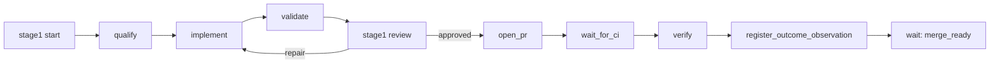

# Operator Guide

This is the operator-facing reference for running Enginery locally: install,
configuration, health checks, the Stage 1 command surface, recovery,
backup/restore, and the security limits an operator must understand before
running real workflows.

Every command shown here is copied from `--help` output or a real, executed
invocation against this repository at the version documented in
[`README.md`](../README.md#status). Enginery is `v0.6.0`. The Stage 1
(issue-to-merge-ready-pull-request) and Stage 2 (plan to verified
release) command surfaces are supported, documented features of this
release; `stage2 status` remains the only Stage 2 CLI command (a
read-only stack inspection — Stage 2's own merge/build/publish
orchestration runs through the release-preparation workflow, not a
shipped `enginery` verb). Stage 3 (incident to hotfix and rollback) is
a shipped, adversarially-tested library surface
(`enginery.incidents`) with no CLI command of its own yet — see
[`docs/adapters.md`](adapters.md#the-incident-to-hotfix-and-rollback-surface).
Stage 4 (governed factory self-improvement) has no CLI surface and is
gate-deferred — see
[Release scope and gate-deferred work](#release-scope-and-gate-deferred-work).

## Installation

`v0.1.0`, `v0.2.0`, `v0.3.0`, `v0.4.0`, `v0.5.0` (2026-08-11), and `v0.6.0`
(2026-10-13, the current release) are published to PyPI and GitHub Releases.
Install the published package with:

```bash
pip install enginery
```

Or install from source:

```bash
git clone https://github.com/Mathews-Tom/Enginery.git
cd Enginery
uv sync --all-extras --dev
```

This requires [`uv`](https://docs.astral.sh/uv/) and Python 3.12 or newer.
Enginery is Apache-2.0 licensed and supports macOS and Linux. **Windows is
not supported in this release.** The approved local-supervisor design binds
process supervision, cancellation, and recovery to POSIX process groups,
signals, and process-start identity; native Windows process supervision and
worktree locking are out of scope until a Windows-specific supervisor
backend is designed and proven.

After installing, run the built-in health check before doing anything else:

```bash
uv run enginery doctor
```

```text
[ok] python_version: running Python 3.12.8; requires >= 3.12
[ok] package_metadata: enginery 0.6.0 installed
```

`enginery doctor --json` emits the same report as a machine-readable
document; every CLI command that reports structured state accepts `--json`
for scripting.

## Configuration

Enginery reads layered configuration (below) when it builds a Stage 1 request and when
`factory init`, `doctor` and `explain` compile it for a project. Every
run's provider configuration is an explicit, versioned `--request` document passed to
`enginery stage1 start` (see
[Running a Stage 1 workflow](#running-a-stage-1-workflow) below): work-item
identity, acceptance criteria, validation commands, and an
`execution_configuration` block naming the GitHub repository, an opaque
GitHub credential reference, the harness provider (`omp` or `claude-code`),
an opaque harness credential reference, and an absolute artifact root. A
credential *reference* is not a credential: the GitHub CLI (`gh`) and the
configured harness CLI (`omp` or `claude`) each resolve their own
already-authenticated local session; Enginery never reads, stores, or
serializes a literal secret value.

The request also carries an `execution_selection` block: the harness a run
requested and, optionally, a model and a native effort, each recorded with
the layer that supplied it, together with the digest of the packaged
execution-control catalog it was resolved against. `build-request` binds the
host's own default model and effort unless `--model` or `--effort` is given (see
[Execution selection and receipts](#execution-selection-and-receipts)); `--strict-effective`
only modifies a pinned model and never changes what is bound. A request document is validated against the packaged catalog when a run
starts, so an alias, an unpinnable effort, a different tested host version or
a support tier the catalog does not assign is rejected. A run persisted
before this block existed keeps its original request digest, decodes
unchanged, and runs as a host default with unknown effective controls;
Enginery never invents a selection for it. If the packaged catalog differs
from the one a run was bound to (for example after upgrading Enginery),
`enginery stage1 watch` reports the diagnostic as `hold` and refuses to
advance the run; the run's original binding is retained, never rebound.

Stage 1's `--database` flag names the SQLite ledger file explicitly. Factory
commands use the project's private `ledger.sqlite` and report its path; pass that
path to Stage 1 commands to act on the same runs. The ledger is the single source of
durable truth: deleting or corrupting it discards every run, node, policy
decision, and evidence record it contains, so back it up (see
[Backup and restore](#backup-and-restore)) before any risky operation.

### Layered configuration

`stage1 build-request` compiles one effective configuration from five layers,
highest precedence first: **run** (the command-line flags), **project**
(`<repository>/.enginery/project.toml`, tracked, and inside the protected
`.enginery/**` set so a worker cannot change its own policy without an operator
decision), **user** (`$XDG_CONFIG_HOME/enginery/user.toml`, default
`~/.config/enginery/user.toml`, private and user-authored; Enginery never creates
or edits it), **workflow** (a packaged, versioned profile: `standard` or
`careful`, chosen with `profile = "..."` in project or user policy or with
`--profile`) and **factory** (packaged defaults). The highest layer that specifies a
field wins; protected paths are additive across layers and never remove a built-in
protected path. A file that is absent is simply not a layer. The request snapshot also
records which layer files were absent and where the user preferences file is looked up,
so creating either file, or starting under a different `XDG_CONFIG_HOME`/`HOME` than the
build, makes `stage1 start` refuse the request until it is rebuilt. A file that is present
is validated strictly: an unknown key or section, a wrong type, an unsupported
`schema_version`, an unknown workflow profile, or, in project policy only, a
credential-shaped key or value is refused with exit code 2 and a message that names
the file, the key and the allowed values. Nothing is ignored or coerced.
`XDG_CONFIG_HOME` and `XDG_STATE_HOME`, when set, must be absolute paths; a relative
value is refused. Private machine state lives under `$XDG_STATE_HOME/enginery/`
(default `~/.local/state/enginery/`).

A layer file has this shape (every key is optional except `schema_version`):

```toml
schema_version = 1
profile = "standard"              # project and user only

[execution]
harness = "omp"                   # omp | claude-code
model = "provider/id"             # a model or effort is a default unless pinned
effort = "high"
model_pinned = false              # true makes the model an exact pin
effort_pinned = false
strict_effective = false

[runner]
mode = "trusted-local"            # trusted-local | isolated-oci; never defaulted
image = "sha256:<image id>"       # isolated-oci only
docker_context = "colima"         # isolated-oci only; user preferences / run flags only
model_access = "none"             # none | relay; isolated-oci only for relay

[validation]
commands = ["uv run pytest -q"]   # shell-split; an isolated run must name its own
required_checks = ["CI"]
repair_limit = 1

[implementation]
time_budget_seconds = 1800
permitted_capabilities = ["git"]
evidence_requirements = ["redacted harness transcript"]

[protection]
paths = ["infra/**"]              # additive: only adds to the built-in protected set

[credentials]                     # opaque reference names, never secrets
github = "operator-gh-cli"
harness = "operator-harness-session"

[executables]                     # user preferences / run flags only; never project policy
github = "gh"
harness = "omp"                   # the executable of whichever harness resolves

[constraints]                     # hard policy: binds every layer, including the run layer
allowed_harnesses = ["omp"]
allowed_models = ["provider/id"]
allowed_efforts = ["low", "medium"]
allowed_runner_modes = ["isolated-oci"]
allowed_capabilities = ["git"]
max_time_budget_seconds = 3600
max_repair_limit = 2
```

Repository content must not choose host programs: `[executables]` is refused in project
policy. Configure host executable paths in user preferences or explicit run flags instead.
Likewise, project policy cannot select `runner.docker_context`; set it in user preferences
or with `--docker-context`.

A higher-layer `trusted-local` mode shadows lower-layer image, Docker context and model
access settings; image, context or `relay` stated at or above the mode-winning layer are
refused, while `model_access = "none"` is always allowed.

A hard constraint is conjunctive: the compiled value must satisfy the constraints of
every layer, so a lower layer cannot loosen what a higher one forbids, and a run flag
that violates a project constraint is refused before any request is written. The trust
mode is never defaulted: some layer (a `--runner` flag or `[runner] mode`) must choose
`trusted-local` or `isolated-oci`, and an isolated run must name validation commands
and an exact image.

The compiled result records, for every field, the value, the winning layer and each
shadowed lower-layer value with its source file and sha256. Its canonical JSON is the
configuration snapshot; the snapshot's sha256 is the request's
`configuration_snapshot_digest`, and `build-request` writes the snapshot into the request
document next to the request. `stage1 start` verifies the digest, agreement with every
carried field, the snapshot's recorded hard constraints and all recorded source digests
(including packaged defaults and workflow profiles). It refuses inconsistent,
policy-violating or drifted requests, or documents without a snapshot; rebuild them with
`enginery stage1 build-request`. Already-started runs are read from the ledger unchanged.
Building a `Stage1RunRequest` directly through the Python API stays supported; a document
submitted to `stage1 start` must carry a consistent, current compiled snapshot.

## Command surface

The full current CLI surface, generated from `enginery --help`:

```text
usage: enginery [-h] [--version]
                {doctor,adapter,ledger,policy,stage1,stage2,outcome,gate,workspace,runner,capability,factory}
                ...

positional arguments:
  {doctor,adapter,ledger,policy,stage1,stage2,outcome,gate,workspace,runner,capability,factory}
    doctor              Report locally implemented prerequisites.
    adapter             Inspect configured adapter providers.
    ledger              Ledger consistency and storage commands.
    policy              Explain policy decisions.
    stage1              Run the Stage 1 issue-to-PR lifecycle.
    stage2              Inspect Stage 2 plan-to-release stack state.
    outcome             Inspect raw outcome observations and completeness.
    gate                Report readiness against a decision gate.
    workspace           Inspect and release run-scoped workspace reservations.
    runner              Build and qualify the isolated worker image and engine.
    capability          Capability lock and scoped install commands.
    factory             Guided setup, manual issue intake, execution and inspection.
```

This is materially narrower than the full command-family list in the system
design document, which also names `init`, `work`, `run`, `evidence`,
`workflow`, `factory-change`, and `gc` families. Those are design targets
for later milestones; they do not exist in this release. Do not document or
script against a command that is not listed above.

| Command | Purpose |
|---|---|
| `enginery doctor [--json]` | Report locally implemented prerequisites (Python version, installed package). |
| `enginery adapter doctor [--json] [--github-repository ...] [--deployment-app-script PATH] ...` | Report the deterministic local provider and Stage 2/3 broker configuration state Enginery ships (see [Local provider inventory and Stage 2/3 broker configuration](#local-provider-inventory-and-stage-23-broker-configuration)). |
| `enginery ledger verify --database PATH [--artifacts PATH] [--json]` | Check ledger and artifact-store consistency. |
| `enginery ledger backup --database PATH --output PATH [--artifacts PATH]` | Snapshot a ledger to a directory. |
| `enginery ledger restore --backup PATH --database PATH [--artifacts PATH]` | Restore a ledger from a backup directory. |
| `enginery ledger rebuild-projections --database PATH` | Rebuild ledger projections from stored events. |
| `enginery policy explain REQUEST [--json]` | Explain a policy decision for a request document without authorizing it. |
| `enginery stage1 {start,watch,review,approve,reject,cancel,resume,evidence,build-request}` | Run and inspect the Stage 1 lifecycle, plus build a `--request` document from a GitHub issue (below). |
| `enginery stage2 status --database PATH --owner OWNER --stack-id ID` | Report one Stage 2 stack's slice states and merge readiness. |
| `enginery outcome {list,show,completeness,interventions,failures}` | Inspect raw outcome observations and completeness. |
| `enginery gate status --gate G4 --database PATH [--floor-config PATH] [--json]` | Report fail-closed G4 readiness from classified completed runs and recorded authority evidence. |
| `enginery gate record-g4-deficiency --database PATH --finding-id ID --deficiency TEXT --cited-run-id RUN_ID ... --evidence-pull-request-number N --producer-principal-id ID --evidence-pull-request-author-login LOGIN --correlation-id ID [--floor-config PATH] [--json]` | Record an immutable recurring-deficiency finding against a verified classified cohort and derive its evidence-PR document digest. |
| `enginery gate record-g4-deficiency-evidence --database PATH --finding-id ID --correlation-id ID --github-repository OWNER/REPO --github-credential-reference REF [--github-executable PATH] [--floor-config PATH] [--json]` | Verify one merged GitHub evidence PR and record its immutable two-human authority evidence. |
| `enginery workspace inspect --database PATH --owner OWNER [--json]` | List every repository's current workspace reservation. |
| `enginery workspace release --database PATH --owner OWNER --repository-id ID --run-id ID [--dry-run] [--json]` | Release a retained workspace reservation with no live lease (below). |
| `enginery factory init --runner MODE [--apply] [--project PATH] [choices...] [--json]` | Preview, or with `--apply` perform, guided project setup (below). |
| `enginery factory doctor [--project PATH] [--json]` | Report the prerequisites the project's compiled selection needs, read-only (below). |
| `enginery factory explain [RUN] [--project PATH] [--json]` | Without RUN, explain current compiled configuration and setup ownership; with RUN, explain its immutable binding. |
| `enginery factory uninstall [--apply] [--project PATH] [--json]` | Preview, or with `--apply` perform, removal of exactly the unmodified files setup created (below). |
| `enginery factory collect [--dry-run] [--project PATH] [--json]` | Preview eligible GitHub issues; without `--dry-run`, record only private intake state. |
| `enginery factory run OWNER/REPO#N [--project PATH] [--once] [--wait-seconds N] [--json]` | Compile, bind and advance an issue through the existing Stage 1 coordinator. |
| `enginery factory status [RUN] [--project PATH] [--json]` | List durable project runs or inspect one run without advancing it. |
| `enginery factory resume RUN [--project PATH] [--wait-seconds N] [--json]` | Reconcile durable workers and pending external operations, then continue the same run. |
| `enginery factory pause [--reason TEXT] [--lift] [--project PATH] [--json]` | Pause project-ledger dispatch, or lift that pause; running workers are untouched. |
| `enginery factory drain (--wait-seconds N \| --stop) [--project PATH] [--json]` | Pause dispatch, then wait for or stop workers through the existing drain path. |
| `enginery capability {lock,inspect,preview,install,uninstall}` | Verify the capability lock; inspect, preview, install, and uninstall scoped capability packages (below). |

### Capability packages

A capability is a package directory (a `capability.json` manifest plus
instruction, reference, script, and data files; see
[Package closures and the lock](adapters.md#package-closures-and-the-lock)),
not a single file. The `enginery capability` group resolves `NAME@VERSION`
requests against typed sources and manages a task-local install:

| Command | Effect |
|---|---|
| `enginery capability lock --check [--lockfile PATH] [--capabilities-root PATH] [--json]` | Verify the content-addressed store against the lockfile. Exit `12` on drift, or on a `..` component or a symbolic link on the store's directory chain; `9` when a component of that chain is not a directory. |
| `enginery capability inspect NAME@VERSION... SOURCE-FLAGS [--lockfile PATH] [--capabilities-root PATH] [--install-root PATH] [--json]` | Report each package's closure digest, trust, license, permissions, compatibility, approval requirement, and the selected source with every shadowed alternative; a shadowed source that fails (offline Armory, missing extra) is reported as that alternative's problem, not fatal. Reads sources only: nothing is materialized, written to the workspace, or executed (URL Git sources and Armory are read over the network). Exit `0`; `3` on drift against the lockfile or a source that cannot be read; `12` on a legacy lockfile or an invalid package; `2` on bad input. |
| `enginery capability preview NAME@VERSION... SOURCE-FLAGS [path flags] [--json]` | The same resolution plus the exact install plan: files to write (task-local destination, kind, size, digest), blockers, and approvals still required. No side effects beyond the same network reads. Exit `0` when ready; otherwise the blocker's code (`3` drift, including a pinned name at another version; `12` license hold or incompatible; `9` conflict; `5` approval required); also `3` on drift or an unreadable source found while resolving, `12` on a legacy lockfile or an invalid package, `2` on bad input. |
| `enginery capability install NAME@VERSION... SOURCE-FLAGS [path flags] [--json]` | Materialize the verified closures and copy them into the install root (only bytes that still hash to the lock are written), then record the owned-install manifest and the lockfile (the installed lock plus earlier pins as retained pins). Refuses license holds, incompatible packages, and destinations it does not own. Exit `0`; `5` when held for approval; `3` on drift or a pinned name at another version; `9` on a conflict (including a non-directory component on a state path); `12` on a license hold, incompatibility, legacy lockfile, invalid package, or a `..` component or symbolic link (including a link loop) on the install root, capabilities root or lockfile path (refused before anything is written); `2` on bad input. |
| `enginery capability uninstall [--lockfile PATH] [--capabilities-root PATH] [--install-root PATH] [--json]` | Revoke the active install record, then remove the owned, unmodified files (see below). Exit `0`; `3` when no install is recorded under the install root; `12` when the install root has a `..` component or is reached through a symbolic link (including a link loop); `9` when a component of the install root is not a directory or cannot be inspected (for example a link into a directory without search permission, which is refused before the link itself is examined); `2` on bad input (including an unreadable owned manifest). |

Source flags (at least one is required; precedence is project, user, git,
Armory — the first source offering `name@version` is selected and the rest
are reported as shadowed):

| Flag | Source |
|---|---|
| `--project-source REPOSITORY@COMMIT`, `--project-subdir DIR` | The reviewed base: a **local** Git repository directory (a URL is refused, exit `2`) pinned to a full 40-hex commit sha, with packages under `DIR` of that commit's tracked tree (`DIR/<name>/capability.json`). The only source that resolves `local_trusted` and installs without approval. Only committed content at that sha is read — never a working tree, the index, or an uncommitted edit — and the sha is recorded as the lock entry's origin revision. The lock entry's source label is `project:<canonical absolute repository path>`, which the lock digest binds. That the commit is the run's reviewed base is the operator's assertion: nothing checks it. A bare directory, an abbreviated sha, or a ref is refused (exit `2`). |
| `--user-source DIR` (repeatable) | User-local package directory; run-introduced and `unauthenticated` (needs approval). The only directory-backed source. |
| `--git-source REPOSITORY@COMMIT` (repeatable), `--git-subdir DIR` | A Git repository (existing directory, or `https://`, `ssh://`, `file://`, `git@host:` URL) pinned to a full 40-hex commit sha; packages are read from `DIR` inside that commit's tracked tree. `unauthenticated` unless a pinned signature verifies. |
| `--armory`, `--armory-revision SHA` | The Armory catalog at one commit (network; needs the `armory` extra). |
| `--replace-legacy-lock` | Resolve fresh past a legacy single-blob lockfile; `install` then replaces that file. |

Path flags default to `.enginery/capabilities.lock.json` (`--lockfile`),
`.enginery/capabilities` (`--capabilities-root`, the content-addressed
store), and `.enginery/installed` (`--install-root`). There is no persistent
Git cache.

**Approval is never recorded by this CLI.** An entry that needs
exact-digest human approval (anything not served by the project source) is
*held*: `install` exits `5`, writes nothing, and prints the exact name,
version, closure digest, and lock digest that would have to be approved
through the existing `capability.materialize` policy action. Programmatic
callers pass digest-bound `ApprovedCapabilities` (computed from their
`PolicyEvaluator` by `approved_capabilities`) to `install_lock`,
`materialize_lock` and `run_package_command`; each approval names the
entry, its closure digest, and the digest of the lock it was given for, so an
approval computed for one lock never authorizes a drifted lock, and a bare
name authorizes nothing. `run_package_command` also requires the install
record to hold the approved closure of the entry it runs. Any change to a
sibling script, reference, dependency pin, license, origin revision, or trust
classification changes the lock digest and supersedes an earlier approval.

**Drift.** When the lockfile already records `name@version`, a source that
now serves a different closure for it is rejected (exit `3`) rather than
silently re-locked; remove the lockfile deliberately to accept changed
content. The lockfile's `entries` are exactly the lock that `install` installed
and that the install record, the `HOLD` output and any approval name, so its
digest is the one bound everywhere. Pins from earlier installs are kept only
as `retained_pins` (name, version, closure digest) outside that digest, so
installing and uninstalling other packages never forgets a pin: both an active
entry and a retained pin block a changed closure. A request for a *different
version* of a name the lockfile pins (in either form) is refused as a drift
blocker by `install` (exit `3`, before anything is written) and reported by
`preview` as a blocker with the same exit `3` — the lockfile pins one version
per name. The lockfile is written atomically and a symlink at its path is
refused on read (exit `2`) and replaced, never followed, on write. A symlink
planted where a write would be redirected is refused on write (exit `12`)
before anything is written, so a planted
`.enginery -> /other/project/.enginery` cannot redirect an install, uninstall
or lock write. The exact rule: a path written with a `..` component is refused
(exit `12`). The named install root and capabilities root are always checked with
`lstat` and must not be symlinks, wherever they are. The anchor is the current
directory (the directory relative paths resolve against). For the lockfile's
directory, the install root, the owned manifest and the capabilities root inside the
anchor (relative, or absolute under it), every existing component strictly below the
anchor must not be a symlink. A path outside the anchor is operator-chosen:
its ancestors are never checked (so `/tmp` or `$TMPDIR` on macOS work), and
what the tool owns beneath them is guarded by the install code.
Whether a path is "inside" the anchor is decided by filesystem identity: the first
prefix of the path, as written, that is the same file as the current directory
(`stat` identity, so a symbolic link to the current directory or another letter case
on a case-insensitive filesystem counts), stopping at the first missing prefix. An
existing component that is not a directory (for example a regular file named
`.enginery`) is refused as a conflict (exit `9`), not a crash. A symbolic link loop is
refused as a symbolic link (exit `12`), and any other component that cannot be inspected
(for example an unsearchable directory) as a conflict (exit `9`), never a crash.
`install` checks the lockfile's directory and the lockfile
itself before it writes anything. The store's own `.tmp`, `<algorithm>` and
`<xx>` directories must not be symbolic links either: materialization and
verification refuse (exit `12`) a store reached through one.
`run_package_command` honors the trust classes recorded in the lock it is given,
so its caller must pass a lock it resolved itself, never one decoded from a
workspace-writable lockfile.
An install
of a different lock than the one recorded under the install root is refused
until the active install is uninstalled.

**Legacy lockfile.** A lockfile in the previous single-blob schema cannot be
read as pins. `inspect`, `preview` and `install` refuse it (exit `12`) and
name `--replace-legacy-lock`: with that flag, resolution starts fresh without
the legacy pins, and `install` then replaces the legacy file with a
current-schema lockfile. Without the flag the legacy file is never touched;
you can also move it aside.

**Read-only commands still read the network.** `inspect` and `preview` write
nothing to the workspace. Every Git source, for every command, is read
through a private bare mirror that the adapter creates in an owner-only
temporary directory, fills with a fetch of exactly the pinned commit (a local
path as a `file://` URL), reads only from, and deletes afterwards: git never
runs inside a repository it did not create, so the fetching side never reads
the source repository's configuration, and no missing object is lazily
fetched. The source's own `git-upload-pack` does read its configuration by
design, so the protection against a hostile source is a patched git: the
adapter checks `git --version` once and refuses (a missing-prerequisite
error) anything older than 2.45.1 or the maintenance releases 2.39.4, 2.40.2,
2.41.1, 2.42.2, 2.43.4 and 2.44.1, including Apple Git 2.39.3 and any
unparseable version. A URL Git source or the Armory
catalog is read over the network, so these commands perform network reads; a
local-directory Git source performs none.

**Run boundary.** A package command runs with a minimal environment, no
shell, bounded output, and a timeout, in its own session. The closure is
verified immediately before the run and the bytes that were verified are
written to a fresh owner-only directory, which the command runs from and
which is removed afterwards, so a change to the content-addressed store
after verification cannot change the code that runs. After the command exits,
however it exits, its whole process group is killed (where the platform has
`os.waitid` the leader is still unreaped at that moment, so the group id
cannot belong to another process; on macOS, which lacks it, the leader is
reaped first and a recycled pid is a residual risk), so a background child
does not outlive the run. This is not containment: a descendant that calls
`setsid` leaves the group and is outside this boundary, and a command can
still use everything the operator's account can (trusted-local is not
isolation). A `.py`, `.js`, `.mjs` or `.ts` script must be run through its
interpreter (`python3` or `node`), never executed directly, so the
interpreter flags always apply; only a `.sh` script may run directly, and its
first line must be exactly `#!/bin/sh`, `#!/bin/bash`, `#!/usr/bin/env sh` or
`#!/usr/bin/env bash` (checked when the closure is built and again on the
verified bytes before exec), because the kernel would otherwise start
whatever interpreter the shebang names without the flags. Python
commands run with `-B -s -E` (no bytecode, no user site-packages, no
`PYTHON*` variables); the command environment also sets `PYTHONNOUSERSITE=1`
and `PYTHONSAFEPATH=1` so a Python started by a shell script skips user
site-packages and the script directory. Node commands run under Node's
permission model,
allowed to read only the copied closure directory (Node 20 or newer; an
older Node is refused), so a bare `require()` cannot reach an ancestor
`node_modules`; that restriction applies only when Node is the top-level
process, which therefore cannot start child processes. Residual risk: any
other interpreter (`sh`, `bash`) and
anything the closure itself ships, including a child interpreter a shell
script starts, runs with the operator's account.
`run_package_command` also refuses to run when the lock's compatibility
receipt was recorded for a different host than the one it runs on.

**Uninstall retention.** `uninstall` removes only files listed in the owned
manifest whose digest still matches, never anything outside the install
root. It revokes first and deletes second: the revocation record
`.enginery-install-revoked-<revoked lock digest hex>-<n>.json` is linked into
place and the owned manifest is removed before any file is deleted, so a
failure to record the revocation aborts with every file still installed (a
revoked install has no authority to run a package command). The record is
hard-linked, which fails rather than replaces when the name exists: an
earlier record is never overwritten (`<n>` counts records for the same lock
digest from 1). Every manifest and record is first written to a fresh
exclusively created temporary file in the install root, synced, and the
directory synced afterwards; a symlink planted at any fixed name is never
followed. It never deletes the content-addressed store, the lockfile, the
ledger, or any evidence or raw artifact, and it reports what it removed and
what it retained (modified files, the store, and the lockfile are listed as
retained).

#### Operator smoke with the committed fixture package

`tests/fixtures/capabilities/project/word-counter` is a reviewed multi-file
package (manifest, instruction, reference, and script) that needs no network.
A project package is committed content, so the recipe commits the fixture to a
scratch repository and pins that commit as the reviewed base; run it from
scratch copies, never from the checkout:

```bash
CHECKOUT=/path/to/enginery
enginery() { uv run --project "$CHECKOUT" enginery "$@"; }
WORK=$(mktemp -d)
commit() { git -C "$WORK/reviewed" -c user.name=smoke -c user.email=smoke@example.invalid commit -q -m "$1"; }

git init -q -b main "$WORK/reviewed"
cp -R "$CHECKOUT/tests/fixtures/capabilities/project" "$WORK/reviewed/capability-packages"
git -C "$WORK/reviewed" add -A && commit "reviewed package"
BASE=$(git -C "$WORK/reviewed" rev-parse HEAD)
PIN=(--project-source "$WORK/reviewed@$BASE" --project-subdir capability-packages)
mkdir "$WORK/project" && cd "$WORK/project"

enginery capability inspect word-counter@1.0.0 "${PIN[@]}"    # exit 0, no files written
enginery capability preview word-counter@1.0.0 "${PIN[@]}"    # exit 0, lists the four files
enginery capability install word-counter@1.0.0 "${PIN[@]}"    # exit 0
enginery capability lock --check                              # exit 0, "no drift"

# An edit that is not committed is not part of the pinned commit:
echo '# changed' >> "$WORK/reviewed/capability-packages/word-counter/scripts/count_words.py"
enginery capability preview word-counter@1.0.0 "${PIN[@]}"    # exit 0, the pinned commit does not see it
enginery capability install word-counter@1.0.0 "${PIN[@]}"    # exit 0, "already installed"

# The same edit, committed, is a different closure under the same name and version:
git -C "$WORK/reviewed" add -A && commit "change the script"
NEW=$(git -C "$WORK/reviewed" rev-parse HEAD)
CHANGED=(--project-source "$WORK/reviewed@$NEW" --project-subdir capability-packages)
enginery capability preview word-counter@1.0.0 "${CHANGED[@]}"    # exit 3, rejected as drift
enginery capability install word-counter@1.0.0 "${CHANGED[@]}"    # exit 3, installed copy untouched
enginery capability preview word-counter@1.0.0 "${PIN[@]}"        # exit 0, the pinned commit still serves the original

# A user directory is never the reviewed base. While the install is active the same closure conflicts:
cp -R "$CHECKOUT/tests/fixtures/capabilities/project" "$WORK/user-packages"
enginery capability install word-counter@1.0.0 --user-source "$WORK/user-packages"    # exit 9, uninstall first

enginery capability uninstall                                      # exit 0
find .enginery -maxdepth 2                                         # store and lockfile remain

# After the uninstall, and in a fresh workspace, the same package is held:
enginery capability install word-counter@1.0.0 --user-source "$WORK/user-packages"    # exit 5, nothing written
mkdir "$WORK/fresh" && cd "$WORK/fresh"
enginery capability install word-counter@1.0.0 --user-source "$WORK/user-packages"    # exit 5, nothing written
```

`uninstall` lists the four owned files as removed and
`.enginery/capabilities` (the content-addressed store) and
`.enginery/capabilities.lock.json` as retained; the revocation record is
`.enginery/installed/.enginery-install-revoked-<lock digest hex>-1.json`. The
held `install` prints a `HOLD word-counter@1.0.0: closure <digest> lock
<digest> …` line with the closure and lock digests to approve, and writes
nothing. The same unmodified `--user-source` copy is held (exit `5`) in a fresh
workspace and in one where the install was uninstalled, and is a conflict
(exit `9`, "an install of lock … is already recorded") while an install is
active. Only a user-source copy whose closure differs from the pinned
`word-counter@1.0.0` is rejected as drift (exit `3`).

### Gate G4 operational evidence

G4 is a measurement gate, not a self-improvement capability. A failing or unmeasured status blocks the later self-improvement work; it never creates a pass through a local flag, manually edited ledger row, or a command transcript.

#### Classify a source work item

For every GitHub source item intended for the classified cohort, apply exactly these two labels, with matching lowercase spelling:

```text
enginery/work-kind/issue | enginery/work-kind/plan
enginery/risk/low | enginery/risk/medium
```

Enginery rejects an absent, unknown, conflicting, duplicate, or case-variant label. It never infers a kind or risk. The source adapter reads the issue and all label pages twice; a source or classification change during that read rejects the snapshot. The serialized request retains the canonical labels, source URL, source revision, and source-bound digest. Legacy or manually constructed requests without this provenance are excluded from classified G4 cohort counts.

Only low-risk `issue` and `plan` work is eligible for direct Stage 1 implementation. Medium-risk classified work remains human-approval-gated. High risk and every other kind are rejected rather than rerouted.

#### Register current authority principals

Use the schema-2 `registered_principals.identities` list in the G4 floor configuration. Each row binds one stable principal ID to one immutable GitHub numeric user ID. A login is retained only as a human-readable diagnostic:

```toml
schema_version = 2

[registered_principals]
identities = [
  { id = "operator-a", github_user_id = 101, github_login = "operator-a-login" },
  { id = "operator-b", github_user_id = 102, github_login = "operator-b-login" },
]
```

Principal IDs and GitHub numeric user IDs must be unique. GitHub logins are also unique case-insensitively, but are never used to authenticate authority. Schema-1 `registered_principals.ids` configuration and any schema-2 row without `github_user_id` are deliberately unsupported. Migrate each opaque ID to a verified GitHub numeric identity; preserve the login only for diagnostics. Do not change the roster to reinterpret a recorded authority decision.

#### Record a recurring-deficiency evidence PR

First record the recurring deficiency. The command rejects any cited run not in the current verified classified cohort:

```bash
uv run enginery gate record-g4-deficiency \
  --database ledger.db \
  --finding-id recurring-validation-failure \
  --deficiency "Validation fails after generated dependency update" \
  --cited-run-id run-001 \
  --cited-run-id run-002 \
  --evidence-pull-request-number 42 \
  --producer-principal-id operator-a \
  --evidence-pull-request-author-login evidence-author-login \
  --correlation-id record-g4-finding-2026q3
```

The command derives a canonical evidence document and digest from the immutable finding: its ID, deficiency, and cited run IDs. Open and merge an evidence PR whose exact UTF-8 body is that canonical document, not a filename or local draft. Its author must not be the finding producer. Two distinct configured humans, neither the author nor producer, must have their current review state `APPROVED` on the exact merged PR head. The verifier binds the PR author and every reviewer to GitHub's numeric `user.id`, not their mutable login; re-review after a push because a stale approval is insufficient.

Run the live verifier only after the PR is merged:

```bash
uv run enginery gate record-g4-deficiency-evidence \
  --database ledger.db \
  --finding-id recurring-validation-failure \
  --correlation-id record-g4-authority-evidence-2026q3 \
  --github-repository OWNER/REPO \
  --github-credential-reference operator-gh-cli \
  --json
```

The command reads the GitHub pull request and every review page. GitHub authentication, API, malformed-payload, missing or non-numeric `user.id`, unmerged-PR, document-digest, stale-head, author/producer, and approver failures stop the command without recording authority evidence. A successful record is immutable; use a new deficiency finding when any cited evidence changes.

#### Inspect status

```bash
uv run enginery gate status --gate G4 --database ledger.db --json
```

The `recurring_evidence_backed_deficiency` condition remains `unmeasured` until a finding cites eligible classified completed runs and an immutable authority record matches its PR number and evidence digest with two principals still in the configured roster. Other G4 conditions remain independent. A passing single condition does not make G4 pass; every reported condition must pass.

### Local provider inventory and Stage 2/3 broker configuration

`enginery adapter doctor --json` reports the deterministic local providers
Enginery ships out of the box — these back local development and the
cumulative Stage-1 gate described in
[Cumulative Stage-1 recovery evidence](#cumulative-stage-1-recovery-evidence),
not a live GitHub/OMP run — plus the real Stage 2 release brokers
(`GitHubReleaseAdapter`, `PyPiAdapter`) and the real Stage 3
`LocalServiceDeploymentAdapter`. Every broker entry is a local
configuration-sanity check only — is the required CLI tool installed
(`gh --version`, `uv --version`), does the deployment fixture's
`app_script` exist, does its `python_executable` resolve — never a
live GitHub, PyPI, or local-service network call:

```text
$ enginery adapter doctor --json
[
  {"kind": "work_ledger",       "provider_id": "local-work-ledger",       "capabilities": ["fetch", "publish"]},
  {"kind": "harness",           "provider_id": "scripted-harness",        "capabilities": ["cancel", "events"]},
  {"kind": "workspace",         "provider_id": "local-git-worktree",      "capabilities": ["create", "cleanup", "retain"]},
  {"kind": "source_control",    "provider_id": "local-git",               "capabilities": ["branches", "commits", "diff"]},
  {"kind": "validation",        "provider_id": "local-validation",        "capabilities": ["commands"]},
  {"kind": "release",           "provider_id": "local-publication",       "capabilities": ["publish", "verify"]},
  {"kind": "deployment",        "provider_id": "local-deployment-fixture","capabilities": ["deploy", "rollback"]},
  {"kind": "capability_source", "provider_id": "local-capability-source", "capabilities": ["discover", "resolve"]},
  {"kind": "release",           "provider_id": "github-release",         "capabilities": ["release_create_and_verify"]},
  {"kind": "release",           "provider_id": "pypi",                   "capabilities": ["publish_and_verify"]},
  {"kind": "deployment",        "provider_id": "local-service-deployment","capabilities": ["deploy", "observe", "rollback"]}
]
```

`github-release` and `pypi` bind to the GitHub repository and PyPI
project name an installed `enginery` distribution's own package
metadata reports (`Project-URL: Repository`, `Name`) — the same source
`scripts/verify_project_identity.py` treats as canonical — never a
fabricated placeholder; `--github-repository`/`--pypi-project-name`
override them, and `--github-executable`/`--pypi-executable` override
the CLI tool checked (default `gh`/`uv`). `local-service-deployment`
checks `--deployment-app-script` (default
`fixtures/enginery-stage3-local-service/app.py`, relative to the
current directory), `--deployment-artifacts-root`/
`--deployment-state-root` (default under `.enginery/`), and
`--deployment-python-executable` (default the running interpreter). A
missing prerequisite reports `"availability": "misconfigured"` or
`"unavailable"` with a `detail` string, never a silent pass, and
`adapter doctor` exits non-zero — the same fail-closed convention
`doctor`/`gate status` already use.

Each entry also carries a content-addressed `fingerprint`; a Stage 1 run
binds to the exact fingerprint of every provider it uses and refuses to
silently resume under a changed adapter (see
[Recovery semantics](#recovery-semantics)).

## Guided project setup

`enginery factory init` resolves explicit choices into the project policy file the
[layered configuration](#layered-configuration) reads, and `enginery factory doctor`
reports what the project still needs. Setup is preview-first and its footprint is
small enough to read in full.

```bash
uv run enginery factory init --runner trusted-local --harness omp \
  --validation-command "uv run pytest -q" --required-check CI          # preview, writes nothing
uv run enginery factory init --runner trusted-local --harness omp \
  --validation-command "uv run pytest -q" --required-check CI --apply  # performs that exact plan
uv run enginery factory doctor
```

`--runner` is required: the trust mode is never defaulted. Other choices are
`--profile`, `--harness`, `--model`, `--effort` (configured defaults, not pins),
`--runner-image`, `--model-access`, repeatable
`--validation-command`, `--required-check`, `--protected-path`, and `--capability
NAME[@VERSION]`; `--project PATH` defaults to the current directory. `--json` emits
canonical JSON.

When a model or effort is configured under `trusted-local`, the preview runs only the
selected harness's read-only version probe (the same probe `build-request` runs).
An out-of-range or unsupported harness version is a hold (exit 5); applying that
plan writes nothing until the harness is resolved. A missing or unidentifiable
harness is not checked by init; `factory doctor` reports it.

Without `--apply`, `init` previews and writes nothing. The preview lists every file it
would create (path, `tracked` or `private`, and the action `create`, `update`,
`unchanged` or `conflict`), every capability install (init performs none), every
network access (none) and every authentication requirement, plus the digest of the
configuration the choices compile to. `--apply` performs exactly that plan:

- **`<project>/.enginery/project.toml`** (tracked) is created, never overwritten. If it
  exists and differs from what init would write it is user-owned: init reports a
  `conflict`, exits 9, and writes nothing at all. If it already holds exactly what init
  would write, nothing changes, so repeating `init` with the same choices is a no-op.
- **A private ownership record** under `$XDG_STATE_HOME/enginery/projects/<id>/`
  lists the files setup created with the sha256 of what it wrote, and the `.enginery`
  directory when setup had to create it. Every newly created private directory has mode
  0700. The record is written before the policy and restored if creating the policy fails.
- Capabilities are never installed by init. For a selected capability that is not
  installed under `.enginery/installed`, init returns a hold (exit 5) naming the exact
  `enginery capability preview` and `install` commands; approvals stay digest-bound
  through the policy registry and init never records one.
- A choice the compiler would refuse (an unknown profile, an image under
  `trusted-local`, a malformed `user.toml`, a relative XDG directory) is refused with
  exit 2 before any file is touched. A symbolic link on any owned state-path component,
  the `.enginery` directory or the policy file is refused at preview and apply; an
  existing non-directory `.enginery` is also refused. Capability names and versions
  must satisfy the capability manifest grammar.

Setup never writes credentials, never installs or changes launchd, systemd or cron
units, MCP servers or global configuration, never edits `user.toml`, and never touches
the ledger, evidence, the capability store or lockfile, or authentication state.

`factory doctor` checks only what the compiled selection needs and never changes
anything: git; the GitHub CLI and its read-only `auth status`; the selected harness
executable through the same host probe `build-request` uses, against the packaged
catalog (skipped for an `isolated-oci` run, which executes the image's pinned harness);
the container engine and the pinned image through the existing runner admission only
for `isolated-oci`; and each permitted capability that is not installed. Every missing
item is a hold that names the exact prerequisite and the command that resolves it, and
the exit code is 5 while any hold remains. A project that declares no trust mode is
itself a hold: set `mode = "trusted-local"` or `mode = "isolated-oci"` in the
existing policy's `[runner]` table (add the table if absent), or declare that choice
in the user preferences. With no policy, the hold names `enginery factory init`.
A malformed policy or user file is invalid input (exit 2), not a hold. Engine holds
name engine installation, startup, qualification or context selection; image holds
name image rebuilding and status; relay holds name relay setup.
Container checks disclose the Docker context in use (or the docker CLI's current context) and list
the container-engine contact in `network_access`. Repair commands carry `--docker-context`
when a context is configured, so they target the same engine. Select a machine-local context
with `docker_context` in `[runner]` in `$XDG_CONFIG_HOME/enginery/user.toml`, or with
`enginery stage1 build-request --docker-context NAME` for a run, never in project policy.


`factory explain` without RUN answers "why would a new run use that value, and what
did setup leave behind?" from the same compiler output `doctor` and `build-request` use. For every
compiled field it prints the value, the winning layer, each shadowed lower-layer value
with its source file and sha256, then the hard constraints that applied, every layer
file with its digest, each file setup created with its status (`owned`,
`user-modified`, `missing`, or `user-owned` for a policy setup did not create), and the
current holds (an undeclared trust mode, a permitted capability that is not installed,
or an incompatible selected harness). It changes nothing and reads local files; when
a model or effort is configured under trusted-local, it also runs the selected harness's
read-only version probe, as `build-request` does. It exits 5 while a hold remains and 2
for malformed configuration. Other host prerequisites remain `doctor`'s job.
Ownership entries are validated before any are reported as owned: the recorded role must
match setup's project-relative path, with no traversal or symbolic links. A tampered
ownership record is invalid input, not evidence of ownership.

### Issue intake

`enginery factory collect --dry-run --project . --json` lists open issues from the
repository's `origin`, excluding pull requests. Exactly one canonical
`enginery/work-kind/issue|plan` and one `enginery/risk/low|medium` label are required.
Missing, duplicated or unknown labels hold the issue with an explicit `gh issue edit N
--repo OWNER/REPO` repair: remove offending labels and choose one of the displayed
allowed work-kind/risk values. No risk is chosen automatically. Authentication or
transient intake failures instead report an `issue intake` hold with authentication
and retry commands. A listing exceeding 100 pages fails loudly rather than truncating.
The preview includes deduplication, selected workflow, harness/model/effort and winning
layers, runner, time budget and the unenforced cost basis. It makes no GitHub mutations
or hosted inference calls; JSON counts `github_auth_probes` separately from issue API
`github_reads`. An existing project ledger is opened read-only without migration.
Read-only inspection of a WAL ledger may create SQLite `ledger.sqlite-wal` and
`ledger.sqlite-shm` sidecar files without changing the ledger's content; any newly
created sidecars are disclosed in `local_writes`, including during a dry run.
The 1 MiB document limit applies to the intake index and request documents, not the ledger.

Without `--dry-run`, collection also records the private `intake/index.json`, its
lock file and every newly created directory from `$XDG_STATE_HOME` (or its default)
through `intake/`, disclosed outermost first before the lock and index paths. Only the repository
`last_seen_updated_at` cursor changes: it cannot advance
past the earliest held or errored issue. Collection never creates issue-to-run bindings;
it reads existing bindings to report `new`, `bound:<run-id>` or `changed:<run-id>`.
The JSON `local_writes` list discloses these paths. Collection never comments, labels,
opens a pull request, merges, deploys, installs a capability or starts a worker.


`factory uninstall` previews by default and, with `--apply`, undoes exactly what
`init` did, using only the private ownership record. It removes the policy file only
while its sha256 still equals the one setup recorded; a file you edited is kept and
reported as user-owned, and a file that is already gone is a no-op. The `.enginery`
directory setup created is removed only while it is empty; otherwise it is listed under
`kept_not_empty`, separately from edited policies under `kept_user_owned`. The ownership
record is removed last, so a second run reports nothing to uninstall. It never touches `user.toml`,
the ledger, evidence and artifacts, the capability store or lockfile, or authentication
state; a record that names any path other than the two setup creates is refused rather
than obeyed, and a symbolic link on the way to either path or the ownership record is refused.

## Manual factory path

After choosing a runner and completing guided setup, collect and run manually:

```sh
enginery factory init --runner trusted-local --apply --project .
enginery factory collect --dry-run --project . --json
enginery factory collect --project . --json
enginery factory run OWNER/REPO#N --project . --json
enginery factory status --project . --json
enginery factory status RUN --project . --json
enginery factory explain RUN --project . --json
enginery stage1 review --database DATABASE --owner factory --run-id RUN \
  --report review.json --repair-attempt 0
enginery factory resume RUN --project . --json
enginery factory pause --reason "operator maintenance" --project . --json
enginery factory drain --wait-seconds 30 --project . --json
# Or stop remaining workers instead of waiting:
enginery factory drain --stop --project . --json
enginery factory pause --lift --project . --json
```

Use the returned `run_id` in place of RUN and `database` in place of DATABASE.
Submit `review.json` in the existing Stage 1 report format once the run awaits
human review; the journey is not an instruction to approve work without inspecting it.
Setup does not install capabilities or authenticate: resolve reported holds first.
Factory control makes no model calls; an implementation worker dispatched by the
coordinator can use the selected coding harness and model. Collection never dispatches a worker.

`factory run` uses the same request compiler and bound-start path as `stage1 start`.
The shared Stage 1 composition supplies runtime selection, inspection and advancing
services; only `Stage1RunService.advance` progresses the run. There is one coordinator,
not a second factory scheduler. The private project ledger uses owner `factory`;
existing Stage 1 commands can open that same database with `--database`.

The command resolves the project repository from `origin`, uses the current branch
and its current commit as the base, and uses the project capability lockfile when
present. `--base-branch` selects a different base branch. Run-layer overrides are
`--model`, `--effort`, `--runner`, `--profile`, `--validation-command`,
`--required-check`, `--protected-path` and `--time-budget-seconds`, with the same
meaning and defaults as `stage1 build-request`; all other settings come from the
compiled project/user/workflow/factory layers. A bound run is not recompiled by
repeating `run` with different overrides. If a previous invocation wrote `request.json`
but never started the run, repeating `run` recompiles it against the current configuration.
A changed request digest replaces that unbound file and reports `request_rebuilt: true`.

The project-specific private state directory contains:

```text
ledger.sqlite
intake/index.json
runs/<run_id>/request.json
runs/<run_id>/workspace/
artifacts/
```

The command reports the database and request paths; these are local runtime state,
not tracked policy. Intake and request writes are atomic and link-safe. The intake
index stores the repository cursor on collection; only `run` binds each issue's run ID
and snapshot digest. Collection never creates issue-to-run bindings.
The run ID is `fr-` followed by the first 20 hexadecimal characters of SHA-256 over
canonical JSON with keys `project`, `issue`, and `snapshot`: project identity, canonical
issue reference from the adapter and bound snapshot digest. The same project/issue/snapshot
reuses the same durable run, request and workspace rather than creating another run.
Issue numbers use positive ASCII digits without leading zeroes; `OWNER/REPO#01` is refused.

`run --once` performs one advance. Otherwise it advances until a hold, block, human
review, terminal state or wait boundary; `--wait-seconds` defaults to zero, returning
at the first wait while the supervised worker may keep running. The wait must be a
finite non-negative number. Idle or unchanged actions back off for 0.5, 1, 2, then
5 seconds between read-only passes; unchanged actions, including verification while
CI is pending, advance the coordinator no more often than every 15 seconds.
CI waits poll no more often than every 15 seconds. The command returns at the deadline
rather than making another idle advance.
Repeating `factory run` for the same bound issue continues that durable run.
An existing unstarted request is recompiled; if its digest differs, it is replaced
before binding and the report discloses `request_rebuilt: true`. Bound requests are
never replaced by that path.
`status` never advances it: without RUN it lists project runs; with RUN it reports
current nodes, next action, worker PID or container identity, selection and winning
layers, runner, budget basis, and holds with repairs. Time budgets are reported in
seconds; cost remains unenforced.

`factory explain RUN` reads the immutable binding: request and configuration digests,
embedded field sources, harness/model/effort, runner, permitted capability subset,
node states and current hold repairs. It does not recompile today's configuration.
Without RUN, `factory explain` retains the current configuration and setup-ownership
explanation described above.

`factory resume RUN` first reconciles exited workers and pending external operations
through the existing Stage 1 service and broker paths, then continues the durable
run. A killed client or coordinator does not require a new request, workspace or run
ID; retrying pending PR publication reconciles its operation identity rather than
creating a second PR. Binding, catalog or runner drift still holds; resume does not
rewrite the binding or bypass those checks. `--wait-seconds` has the same wait-boundary
meaning as on `run`. This is distinct from `stage1 resume --database DATABASE
--owner factory --run-id RUN --node-id NODE --attempt-id ATTEMPT --operation-id OPERATION`,
which requeues a human-wait node; its flags and semantics are unchanged.

`factory pause` reports its scope as the **project ledger**, not the whole host or
another project's ledger. Running workers are untouched. Both `run` and `resume`
hold while dispatch is paused; lift it with `factory pause --lift --project .`.
`factory drain --wait-seconds N` pauses and waits for running workers, reporting
`released: by resume/reconcile`: observing an exit does not collect its result or
release its lease/workspace reservation. Lift the pause, then run
`enginery factory resume RUN --project .` to reconcile those exited workers through
the authoritative lifecycle. Reconciliation releases the worker lease; a successful
implementation's workspace remains **retained**, including after verification, until
explicitly released. `status` and `drain` show that retention and its release command.
A timeout reports the workers still running.
`factory drain --stop` pauses and stops live workers using the existing supervisor
path; successful stop cleanup reports `released: now` for those stopped workers,
releases their leases/workspace reservations, and removes isolated worker containers
using each run's bound engine context. Per-worker `container_cleanup` reports removal
or that a trusted-local run has no container. Removal failures produce partial release
and a non-success exit code. Workers that had already exited still require
resume/reconciliation. Partial cleanup is reported explicitly, never called complete.
Neither form cancels or reverses external effects, and the pause remains until
explicitly lifted.

Terminal review remains `enginery stage1 review` against the returned database and
run ID. The independent review gate reports `next_decision` with
`enginery stage1 review --database DB --owner factory --run-id RUN --report REPORT.json
--repair-attempt N`, using the current implementation's repair index (zero initially).
Supply the review report in the existing Stage 1 format. Other human-wait nodes
report matching `stage1 approve` and `stage1 reject` commands with the waiting node ID
and required `--reason REASON`; a failed implementation without a human-wait node reports
its failure as a hold with an `enginery factory run ISSUE --project P` repair using
the bound issue rather than suggesting an inapplicable review. A `blocked` action instead
reports a hold with its recorded reason and matching repair; it is not an approval
or a successful validation. The other Stage 1 commands retain their flags and output.
There is no factory review UI. This path ends at a verified open PR plus outcome
observation. Merge, release and deployment are separate human actions, never actions
performed by this factory path.

The factory preserves the shared watch document's aggregate `status`, which the existing
Stage 1 lifecycle may retain as `created`; it does not invent a run-state transition.
Its `terminal_decision: merge_ready` and `workflow_complete: true` require durable
verification success, the recorded PR outcome, an outcome-observation registration and
the coordinator's `wait` action. `terminal_evidence` names those source records and fields.
This means **an open verified PR awaiting a separate human merge decision**, not a merged PR.
The existing Stage 1 outcome projection also writes one visible, operation-marked lifecycle
comment to the issue and reconciles it before retrying. This is disclosed in gate effect
counts; it is not a hidden issue reply. Collection itself still performs zero GitHub mutations.

### Manual-path holds

Holds report repairs; replace placeholders with the values reported for the run:

| Hold | Repair |
|---|---|
| Missing or unparseable `origin` | `git remote add origin https://github.com/OWNER/REPO.git`; correct an existing remote with `git remote set-url origin https://github.com/OWNER/REPO.git`. |
| Missing or unauthenticated GitHub CLI | Install `gh`, then `gh auth login`; inspect prerequisites with `enginery factory doctor --project .`. |
| Missing, duplicate or unknown canonical labels | Use `gh issue edit N --repo OWNER/REPO --remove-label INVALID_LABEL` for conflicting labels, then `gh issue edit N --repo OWNER/REPO --add-label 'enginery/work-kind/<issue\|plan>' --add-label 'enginery/risk/<low\|medium>'`, replacing each quoted placeholder with the human-selected supported value. Exactly one supported label in each family is required; no risk is selected by default. |
| Missing runner selection | `enginery factory init --runner trusted-local --apply --project .`, or select the intended isolated runner and satisfy its reported admission repair. Trusted-local is not containment. |
| Missing or unapproved selected capability | Run the reported `enginery capability preview NAME@VERSION --project-source REPOSITORY@COMMIT --project-subdir DIR` then `enginery capability install NAME@VERSION --project-source REPOSITORY@COMMIT --project-subdir DIR` from the project. If approval is required, obtain owner approval for the exact closure and lock digest; collection never grants approval or installs packages. |
| Paused dispatch | `enginery factory pause --lift --project .`. Running workers were not stopped by pause. |
| Retained workspace blocks a new run | `factory status` reports `workspace.status: retained` for its owner, and a new run reports a hold with the exact `enginery workspace release --database DATABASE --owner factory --repository-id OWNER/REPO --run-id RETAINING_RUN --json` command. Inspect the retained run before explicitly releasing it; then retry the new run. Release is never performed silently. |
| Issue changed since the run was bound | Inspect `enginery factory status RUN --project .`; drain with `enginery factory drain --stop --project .`. Where cancellation is appropriate, use the complete command `enginery stage1 cancel --database DATABASE --owner factory --run-id RUN --node-id implement`. Lift the pause with `enginery factory pause --lift --project .`, then explicitly create the new binding with `enginery factory run OWNER/REPO#N --supersede --project .`. The old run remains durable and visible. |
| Supersede cannot prove the old run safe | `--supersede` requires terminal `run.status`, or terminal latest `runtime_node[RUN:implement].status` with no active `node_leases[RUN:implement]`, no live worker-supervisor attempt and no pending `runtime_node[RUN:open_pr]`. The hold reports these statuses, implementation/lease attempt IDs and lease expiry; drain/cancel, lift pause, then retry the explicit supersede repair above. |
| Awaiting human review | `next_decision` names the exact `enginery stage1 review --database DB --owner factory --run-id RUN --report REPORT.json --repair-attempt N` command; this is a decision boundary, not a hold or successful validation. |
| Blocked progression | The hold preserves the recorded reason and its matching repair; resolve that cause before resuming. |
| Catalog, host fingerprint or runner drift | Restore the bound catalog/host/runner as directed by the reported hold, then `enginery factory resume RUN --project .`; otherwise rebuild under an explicitly new binding. Resume never silently rebinds a run. See [Execution selection and receipts](#execution-selection-and-receipts) for reason-specific permanent holds. |
| Worker identity cannot be proven | Resolve the worker on its launching host. No automatic resumption or forced cancellation is supported for an unprovable identity; see [Queued work, wakeups and worker recovery](#queued-work-wakeups-and-worker-recovery). |

Only factory `review`, `watch` and `evidence` remain proposed and must not be
scripted against. Scheduled collection/watch is not shipped.

## Running a Stage 1 workflow

Stage 1 takes one issue-shaped work item from qualification through an
open, current-head-CI-verified, `merge_ready` pull request. It never
merges — merging is a separately policy-gated Stage 2 action.



### Composing a request

`stage1 start --request` needs a JSON document decodable by
`stage1_request_from_state`. `enginery stage1 build-request` writes one for a
GitHub issue, instead of the hand-written Python composition in
[`docs/examples.md`](examples.md#example-b-real-github-issue-with-an-omp-or-claude-code-harness):

```bash
uv run enginery stage1 build-request \
  --runner trusted-local \
  --output request.json \
  --run-id issue-142 \
  --repository <owner>/<repo> \
  --external-reference "<owner>/<repo>#142" \
  --base-revision <real base revision> \
  --repository-path <absolute path to the local checkout> \
  --workspace-path <absolute path to a fresh workspace directory> \
  --artifact-root <absolute path to an artifact directory>
```

What the issue decides is not a flag. `build-request` reads the issue named by
`--external-reference` (`OWNER/REPO#N`, not an issue URL) through the same GitHub
adapter `stage1 watch --advance` qualifies with — the `gh` named by
`--github-executable` (default `gh`), the `--github-credential-reference`
(default `operator-gh-cli`), and the repository from `--github-repository`
(default `--repository`) — and writes the snapshot it returns exactly as returned:
the title, the body (which is also the run's single acceptance criterion), the source
URL and revision, and the declared classification from the issue's one
`enginery/work-kind/*` label (`issue` or `plan`) and one `enginery/risk/*` label
(`low` or `medium`). The request therefore carries the digest that qualification
recomputes from the same issue, and `watch --advance` qualifies it. If the issue
changes after the request is built (its body, its labels, or its update time), the
next `watch --advance` reports stale evidence (exit code 10) instead of qualifying,
and the request must be rebuilt. An issue without exactly one declared work-kind
and one declared risk label, or with a label outside that vocabulary, is refused
with exit code 2 and no file is written. `--inapplicable-criterion INDEX` marks a
criterion of the issue as not applicable to this run (`0` for the issue body).
`--work-item-id`, `--source-provider`, `--work-kind`, `--source-snapshot-reference`,
`--source-revision`, `--title`, `--objective`, `--acceptance-criterion`,
`--constraint`, and `--risk-class` no longer exist; a command line that passes one is
rejected as an unrecognized argument.

Every flag other than the run's identity and paths is a run-layer override of the
[layered configuration](#layered-configuration): omitted, the project, user, workflow
and factory layers decide, and the factory layer carries the defaults
`docs/examples.md` documents (`uv run pytest -q` for trusted-local
runs only: an isolated run must pass `--validation-command`,
`repair-limit 1`, a 1800-second OMP implementation attempt with no cost budget
(see [Authority separation](#authority-separation)), `operator-gh-cli`/`operator-harness-session` credential
references). The trust mode has no default: pass `--runner` or set `[runner] mode` in
project policy. `--profile` selects the packaged workflow profile. `--capability-lockfile` (default
`.enginery/capabilities.lock.json`) binds the request's
`capability_lock_digest` to the real lockfile `enginery capability
lock` already reads when one exists, and to the documented
no-capabilities-locked sentinel otherwise.
The policy-set version `policy-v1` is a `build-request` argparse default, not a
factory configuration value.
`--environment-manifest-digest`/`--environment-manifest-file` bind the opaque
environment `Run` digest to real bytes when a real environment manifest exists; omitted,
it falls back to the fixed local-environment sentinel the documented manual script uses.
The configuration digest is never supplied: it is always the sha256 of the compiled
snapshot, and `--configuration-snapshot-digest`/`--configuration-snapshot-file` no
longer exist. The only provider the command
contacts is GitHub, through `gh`, to read the issue (after it has compiled the
configuration and validated the pins, so a rejected `--model` or `--effort` never
reaches GitHub); it never runs
OMP or Claude Code, and it writes only the local request file.

A new `stage1 start` accepts only a request whose manifest binds the current check
contracts. Requests written by `v0.5.0`'s `stage1 build-request` (manifest schema 1)
are rejected at start and must be rebuilt with the current `enginery stage1 build-request`.
A run already started from such a request is read and resumed unchanged. A validation
command that launches a shell interpreter is also rejected at start.

Every step after `stage1 start` runs through `enginery stage1 watch
--advance`, which performs **at most one durable next action** derived
purely from the ledger and returns the next action still pending:

```bash
uv run enginery stage1 start --database ledger.db --owner operator --request request.json
uv run enginery stage1 watch --database ledger.db --owner operator --run-id run-1 --advance
# repeat `watch --advance` until `next_action` reports `wait`
uv run enginery stage1 review --database ledger.db --owner operator --run-id run-1 \
  --report review.json --repair-attempt 0
uv run enginery stage1 evidence --database ledger.db --owner operator --run-id run-1
```

`stage1 review` is a separate command because it records an independent
human or reviewer decision `watch --advance` cannot manufacture on its own.
`stage1 approve` / `stage1 reject` resolve a node the run is durably waiting
on a human decision for; `stage1 cancel` terminates a running or
human-waiting node; `stage1 resume` restarts a specific human-wait node
after a durable interruption. `stage1 evidence` prints the run's current
status, request digest, source revision, every runtime node's state, and an
`execution` block (see [Execution selection and receipts](#execution-selection-and-receipts))
— the operator's read path for "what is this run doing and why."

### Execution selection and receipts

`stage1 build-request` accepts three optional flags that pin the run's execution
controls at the run layer:

- `--model` pins an exact model. For `omp` it must be provider-qualified
  (`provider/id`); for `claude-code` it must be a full model name, not an alias
  such as `opus` or `sonnet`.
- `--effort` pins the harness's own native effort level (`omp`: `off`, `minimal`,
  `low`, `medium`, `high`, `xhigh`, `max`; `claude-code`: `low`, `medium`, `high`,
  `xhigh`, `max`). The vocabularies are not mapped onto each other, and OMP's
  `auto` cannot be pinned because it hands the choice to the host.
- `--strict-effective` is a modifier for `--model`, not a pin: it requires `--model`
  and holds the run unless the host reports exactly the pinned model. Neither host
  reports the effective effort, so `build-request` rejects it together with `--effort`
  (exit code 2, no file written, and the same check applies when a run starts) rather
  than spend a worker session on a run that cannot pass.

When a pin is requested, `build-request` also runs the host's own version command
once and records the observed version in the selection, next to the catalog's
accepted range and tested version. An installed host that is outside the accepted
range, is a pre-release or otherwise non-numeric version, or speaks a different
protocol is rejected there too (exit code 3, no file written); a host that cannot be
run records no observation and is rejected again before launch. A run that pins
nothing never probes the host.

Unsupported pins are rejected by `build-request` itself, with exit code 2 and
before any file is written. Omitted flags leave the host's own default, which is
shown as `host default`, never as a level. Pins are exact: there is no fuzzy
matching, no fallback model, and no retry with a different model or effort after a
failure.

`stage1 watch` and `stage1 evidence` print an `execution` block that keeps four
things apart: `requested` (the value and the layer that supplied it), `selected`,
`submitted` (the control arguments extracted from the command that was actually
launched, once the implementation has run) and `effective` (the model the host
reported, or `unknown` with the reason; the effective effort is always `unknown`
today). It also carries the support tier (both hosts are `experimental`), the
catalog version and digest, the `host` block (the binding, the accepted version range,
the tested version, the version observed when the request was built
(`observed_executable_version_at_bind`), the version observed when the dispatch command was built
(`observed_executable_version_at_launch`; for queued work this is when the work was queued,
not when its process later started, and it is read back from the persisted command rather
than probed again at collection), whether those two differ
(`observed_version_changed_since_bind`), the version the binding check observed while
producing this report (`observed_executable_version_at_resume`, the same check every
dispatch and resume makes before it decides whether to hold), and the protocol
fingerprint; an observed
version inside the range is never reported as tested), and any `holds`. A version change
inside the bound range between the two observations runs normally and is visible there;
it never raises a hold. The same hold is also printed as the
top-level `hold`. Only the host's executable version is probed (a read-only
diagnostic creates no files); its protocol is the one the adapter declares. A
matching fingerprint or a captured launch request does not raise a host above
`experimental`.

A held run is not advanced, and its original binding is never rewritten. Recovery
depends on the reason, and `stage1 resume` does not clear a hold:

| Hold reason | Cause | Recovery |
|---|---|---|
| `catalog_drift` | The packaged catalog no longer matches the one the run was bound to (for example after upgrading Enginery). It holds unpinned host-default runs too, not only pinned ones. | Restore the Enginery version (catalog) the run was bound to and re-run `stage1 watch`, or start a new run from a rebuilt request. |
| `host_fingerprint_drift` | A run that pinned a native control, and the installed host is outside the version range the run was bound to (or is a pre-release or otherwise non-numeric version), has a different protocol, or cannot be probed. A version change that stays inside the bound range is not a hold. A run bound to a frozen exact-version catalog (1 or 2) holds on any version difference. | Restore a host version inside the bound range and re-run `watch`, or rebuild the request. |
| `effective_control_unverified`, `effective_control_mismatch` | A strict requirement was not met after the worker ran: the effective model was unknown, differed, or the host reported more than one. | Permanent for that run: its implementation attempt is failed. Rebuild the request. |
| `submitted_controls_mismatch` | The launched command did not carry exactly the selected controls (a missing pin or an extra flag such as `--fallback-model`). | Permanent for that run. Rebuild the request. |
| `worker_identity_unprovable` | A running implementation's worker cannot be proven alive or dead from this host: its record is from another machine, or its identity is unreadable. (A reused pid or a reboot proves the worker gone and is reconciled instead.) | There is no supported release for it in this release: the node keeps its slot. Deal with the worker where it was launched; `stage1 cancel` refuses without signalling (see [Queued work, wakeups and worker recovery](#queued-work-wakeups-and-worker-recovery)). |

## Recovery semantics

Enginery permits **one active coordinator per SQLite ledger**. There is no
separate "recovery mode": restarting the `enginery` process and re-running
`stage1 watch --advance` against the same `--database` file *is* recovery.
The ledger, not any in-memory state, is authoritative. Every coordinator
epoch and node lease carries a fencing token; a stale process's write is
rejected even if it is still technically running. If the prior process
cannot be proven dead and its workspace quiescent, Enginery refuses
automatic resumption rather than risk a duplicate side effect (opening a
second pull request, re-running a completed check, and so on).

This protects against **accidental** orphan continuation. It is not hostile-
process containment: git worktrees isolate concurrent runs from each other,
not a compromised or malicious process from the operator's account,
filesystem, network, or keychain. See
[Security limits](#security-limits) below.

### Inspecting and releasing a stuck workspace reservation

A run's `implement` node reserves one workspace per repository for the
run's lifetime. If a run is aborted outside the normal lifecycle (the
process was killed, or a human decides not to continue), that
reservation can outlive the run. `enginery workspace inspect` lists
every repository's current reservation (with its workspace `mode` and the resolved base
object id `base_oid`), from the same durable state
`stage1`'s coordinator already reads:

```bash
uv run enginery workspace inspect --database ledger.db --owner operator --json
```

`enginery workspace release` releases one reservation through
`CoordinatorRuntime.release_workspace` -- the identical fenced-proof
check the coordinator already enforces internally, not a weaker
CLI-only check: it refuses unless the reservation belongs to the given
`--run-id` and its status is `retained` (a human-wait or otherwise
quiesced workspace with no live worker lease). A `materialized`
workspace -- one a live worker still holds -- is always refused.
`--dry-run` reports whether release would succeed, and why not when it
would not, without releasing anything:

```bash
uv run enginery workspace release --database ledger.db --owner operator \
  --repository-id owner/repo --run-id run-1 --dry-run
# review the dry-run output, then, only once satisfied, drop --dry-run
uv run enginery workspace release --database ledger.db --owner operator \
  --repository-id owner/repo --run-id run-1
```

**This command is destructive** -- it removes the reserved git
worktree. Always run `--dry-run` first and review its output before
running the real release, especially in an unattended or scripted
context.

### Queued work, wakeups and worker recovery

`stage1`'s scheduler enforces one global concurrency slot and one
per-repository slot by default (matching every documented `stage1`
invocation above). When the `implement` node is registered while
another run holds the slot, it is a durable, visible `queued` state,
not an error.

**What `stage1 watch` shows.** The run's `next_action` is
`dispatch_queued`, the `implement` node's `status` is `queued`, and its
`wakeup` record says why it is waiting:

| `wakeup` field | Meaning |
| --- | --- |
| `reason` | `global_capacity`, `repository_capacity`, `dependencies`, `dependency_failed`, `requirements`, `capacity_reserved_for_other_run`, or `execution_hold` |
| `reserved_for` | the run that holds the reservation when `reason` is `capacity_reserved_for_other_run`, otherwise `null` |
| `queued_since` | when the node entered the queue (set when it was registered); the oldest value is granted capacity first |
| `evaluations` | how many times a coordinator evaluated it |
| `last_evaluated_epoch`, `last_evaluated_at` | the coordinator epoch and time of the latest evaluation |

Once the node is dispatched, `reason` becomes `null` and the record
gains `dispatched_at` and `dispatched_epoch`. The record lives on the
durable runtime node, so any coordinator process reads the same
answer after a restart.

**How redispatch happens, and its bound.** There is no daemon or
timer. Readiness is re-derived from the ledger on every
`stage1 watch --advance`: the first advance of a queued node's own run
after its capacity or dependency is released dispatches that same
operation exactly once (same operation identity, no second lease or
worker). Capacity is granted by one fair plan over every run on the
ledger: oldest queued first, by the durable `queued_since` time kept on
each runtime node, with run id as the tie-break. The order comes only
from persisted state, so every CLI invocation derives the same one and
a later-arriving run never overtakes an older queued run, whatever its
run id. A freed slot therefore goes to the oldest queued run rather than
to whichever run
advances first. Each command launches only its own run's node, behind
that run's own binding checks. A slot granted to another run stays
reserved for it: the waiting run shows
`capacity_reserved_for_other_run` and the `reserved_for` run id. With
no daemon, a fair winner that is never advanced keeps its reservation;
recovery is to run `stage1 watch --advance` on that run, or cancel its
node so the reservation is released.

**Holds.** A run whose execution catalog binding has drifted has
`next_action` `hold`, and its queued node is never dispatched. Because
a held run could otherwise be the oldest fair winner and keep a slot
reserved that no command may use, queued nodes of runs held for catalog
drift are left out of the fair plan: another run can take the slot, and
the held node records `reason: execution_hold` with the hold message in
`detail`, not a reservation, only when another run's tick evaluates
it. This is decided from the ledger's durable
run requests and the current catalog alone. A host-fingerprint hold
(`host_fingerprint_drift`) needs a probe of the installed host and is
not applied to other runs' planning, so a run held that way and queued
as the oldest winner still keeps its reservation until the host is
restored or the node is cancelled. That is a remaining manual case.

**Worker liveness.** For a `running` node, `watch` and `evidence`
report a `worker` object built from the persisted identity: `pid`,
`process_group_id`, `start_identity`, `host` (`machine_id`, `boot_id`
and the display-only `hostname`), `identity_version`, `attempt_id`, the
lease epoch, the current coordinator epoch and `lease_epoch_active`.
`lease_epoch_active` is true only while the coordinator epoch that
launched the worker (the epoch of its lease) is still active; a newer
coordinator owning the ledger does not make it true. `liveness` is:

- `alive`: the exact process (same start identity) still holds its pid
  on this host and boot. With `lease_epoch_active: false` the worker is
  running but the coordinator that launched it has lapsed.
- `exited`: the pid is gone. This is worker death, independent of the
  coordinator heartbeat.
- `pid_reused`: the pid now belongs to a different process on this host
  and boot, including one owned by another user that this user cannot
  signal. The worker is gone, but the pid is not its own: it is
  reconciled automatically and never terminated.
- `rebooted`: the record has this machine's id but an earlier boot id,
  so the worker cannot have survived. It is reconciled as
  `worker_lost_to_reboot` and never signalled.
- `foreign_host`: the record was written on another machine.
- `unverifiable`: the record has no usable identity (for example a
  launch that never recorded one, or an unknown identity version), this
  host's own identity could not be read, or it is a pre-host-binding
  record whose pid is present with a start time that does not match.

The host is identified by a stable machine id and boot id, never by
hostname: on macOS the platform UUID (`IOPlatformUUID`) and
`kern.bootsessionuuid` (falling back to the numeric `sec.usec` of
`kern.boottime`, never its time-zone formatted text); on Linux
`/etc/machine-id` (or `/var/lib/dbus/machine-id`) and
`/proc/sys/kernel/random/boot_id`. Renaming the machine or changing the
time zone does not change the identity, and an id that cannot be read
fails closed rather than being guessed. Records written before host
binding carry no host or version; they decode unchanged and are judged
under single-host semantics, as they always were.

The worker's start time is read under a fixed time zone and locale
(`TZ=UTC0`, `LC_ALL=C`), so launching, watching and cancelling from
shells with different `TZ` or `LANG` agree on whether the same worker is
alive. A record written before host binding was formatted under its
launching shell's time zone, which is unknown: if its pid is present
and the start time does not match, the record is held as `unverifiable`
rather than treated as a reused pid, because the process may be the
same live worker. A legacy record whose pid is free is still `exited`.

**When a worker dies.** If a `running` implementation has no result
file and its worker is gone (`exited`, `pid_reused` or `rebooted`),
the next `stage1 watch --advance` (`next_action: reconcile_worker`)
looks once more for a result, then records the exit, reconciles it
through the recovery path and records the node as `failed` with
`failure_reason: worker_exited_without_result` (`worker_lost_to_reboot`
after a reboot) and the worker's pid, process group, start identity,
`liveness` and host in `worker_exit_evidence`. The workspace is
retained, the slot is freed for the next queued run, and the worker is
never launched again. A pid that now belongs to another process, or a
host that rebooted, is never signalled. If a result file exists and no
cancel is pending it is collected first, including one written between
deriving the action and acting on it. A worker that is alive on this
host and boot keeps the run at `wait`, including once 60 seconds pass
without the launching
epoch being renewed: with no daemon that happens between `watch
--advance` calls, and it shows only as `lease_epoch_active: false` in
the worker report. A worker that cannot be proven dead is never
failed: `next_action` is `hold` with `worker_identity_unprovable` and
the `liveness` that blocked it (`foreign_host`, `unverifiable`). If an
operator cancel was interrupted after its termination request, the
next advance finishes it as `cancelled` before it considers any result
file, so the cancel wins over a result that arrived after it, and it is
never recorded as a worker death.

**Manual holds.** A `foreign_host` worker was recorded on another
machine, so nothing here can prove whether it is still running; an
`unverifiable` record (no identity, or a pre-host-binding record whose
present pid has a start time that cannot be compared) has nothing to
prove it from. Recovery refuses automatic resume, `stage1 watch
--advance` reports the hold and `stage1 cancel` refuses, in each case
without signalling anything. There is no supported release for such a
node in this release: it keeps its workspace and its slot, and no
command frees them. Deal with the worker where it was launched. A
reused pid and a reboot of a host-bound record are not holds: both
prove the worker gone and are reconciled automatically, without a
signal.

**Cancel semantics.** `stage1 cancel --node-id implement` is fenced by
the current coordinator epoch, so it works from a later process or
after a restart, when the worker's lease was issued by an earlier
epoch.

- A *queued* node becomes `cancelled`; its `wakeup` record is kept, it
  never holds a lease, and releasing capacity later cannot revive it.
- A *running* node has its whole process group terminated (SIGTERM,
  then SIGKILL after a 10 second grace, waiting until the leader and
  every member have exited), the worker identity and termination events
  are recorded, and the node becomes `cancelled`. If the workspace is
  quiescent it is cleaned. If it is not (for example a git lock is
  held), the node stays `awaiting_human` with
  `cancellation_cleanup_reason`, and `next_action` is `wait`: make the
  workspace quiescent, then run `stage1 cancel --node-id implement`
  again.
- Cancel is safe to repeat. An interruption after the termination
  request, before the exit was recorded, or inside workspace cleanup
  resumes from the recorded state: the exact identity is terminated
  again (a no-op if it is already gone), an interrupted cleanup resumes
  and a workspace already recorded as cleaned is not cleaned again, and
  the single cancellation is recorded once.

A cancelled `implement` node leaves the run at `await_human_review`
with its evidence kept. There is no supported re-implementation inside
that run: start a new run from a rebuilt request. (`stage1 review` can
start a fresh implementation attempt only after a failed required CI
check, within the run's `repair_limit`.)

**Worker output.** A launched worker does not inherit the coordinator's
stdin, stdout or stderr, so piping `stage1 watch --advance` to a reader
returns when the command does. The OMP result is read from the worker's
protocol file. The worker wrapper's own stderr (for example a crash
trace) is appended to a private file, mode 0600, at
`<artifact-root>/worker-logs/<run-id>-implement-<attempt-id>.stderr.log`,
and its stdout is discarded.

**Remaining manual cases.**

- A queued run that is never advanced is never dispatched, and a fair
  winner that is never advanced holds its reservation (see above).
- A run held for host-fingerprint drift that is the oldest winner
  (see Holds).
- A worker recorded on another machine or whose identity is unreadable
  (`foreign_host`, `unverifiable`): there is no supported release for
  it in this release, and its node keeps its slot (see Manual holds).
- A worker that died while its workspace is not quiescent (for example
  a git lock is held): the node stays `awaiting_human` with
  `cancellation_cleanup_reason` and `next_action` `wait`. Make the
  workspace quiescent, then run `stage1 cancel --node-id implement`.
- Attempt ids are ledger-wide, so `build-request` defaults the
  implementation attempt id to `<run-id>-implement-0` and repair
  attempts are derived as `<run-id>-implement-N`; runs sharing one
  ledger need no extra flag. A run id too long to carry the suffix
  within the 128 character identifier limit is rejected at
  `build-request` with exit code 2. An explicit
  `--implementation-attempt-id` is honored and must be unique on the
  ledger. A run persisted with the older `implement-0` default keeps
  that id.

### Cumulative restart/replay evidence

`scripts/full_system_gate.py --stages 1,2,3 --restart-between-stages`
drives Stage 1 (two independent local work items through the full
lifecycle above), Stage 2 (a fixture package through merge -> prepare
-> build -> publish -> verify, with no live GitHub/PyPI network or
credential access), and Stage 3 (a real, ledger-backed incident through
ingest -> hotfix -> deploy -> observe -> roll back -> restore against a
real local HTTP service subprocess) on their own durable SQLite
ledgers, closing every in-memory coordinator/service object and
reopening it from durable state alone before every externally
observable step. This is this repository's established restart-proof
convention — a freshly constructed coordinator over the same on-disk
ledger, matching the recovery topology's coordinator-epoch model — not
a literal new operating-system process boundary. Qualification,
implementation dispatch, and validation are completed through direct
durable node-state transitions in the Stage 1 leg rather than the real
executors; those three nodes' own crash/fault-injection coverage
already exists in the merged Stage 1 implementation stack. `--stages`
accepts any combination of `1`, `2`, and `3`; Stage 4's cumulative gate
belongs to its own gate-deferred, unversioned train once gate G4
passes. See [`docs/RELEASE_EVIDENCE.md`](RELEASE_EVIDENCE.md) (newest release
first) for the exact evidence digests
each release's gate run produced, and
[`docs/release-readiness-v0.1.0.md`](release-readiness-v0.1.0.md) for
the measured local performance baseline from
`scripts/performance_baseline.py`.

## Backup and restore

```bash
uv run enginery ledger backup --database ledger.db --output backup-dir [--artifacts artifacts-dir]
uv run enginery ledger restore --backup backup-dir --database ledger.db [--artifacts artifacts-dir]
uv run enginery ledger verify --database ledger.db [--artifacts artifacts-dir]
```

`backup` copies files; it never mutates a live ledger's own tables in
place. `restore` writes into `--database`, so restoring over a live ledger
discards its current state — back up the current file first if it might
still be needed. `verify` checks event/projection/artifact consistency
without mutating anything and is safe to run at any time, including
against a live ledger. Run `verify` after any restore and before resuming
a run against a restored ledger.

For the operator-side flow (pause, drain, verified backup, restore that keeps the
prior ledger and starts paused) see [Operator recovery entry
point](#operator-recovery-entry-point).

`ledger rebuild-projections` recomputes every projection from the stored
event log; use it if a projection appears stale or inconsistent after a
manual intervention. It never rewrites historical events.

## Trust modes and the isolated runner

Every Stage 1 run is bound, when its request is built, to exactly one
trust mode. `enginery stage1 build-request` requires the choice:

```bash
uv run enginery stage1 build-request ... --runner trusted-local
uv run enginery stage1 build-request ... --runner isolated-oci --runner-image sha256:<image id> [--docker-context NAME] [--model-access none|relay]
```

- **`trusted-local`** runs the worker as you, in a git worktree of your
  repository, with your filesystem and an explicit allowlist of your environment
  (see [Authority separation](#authority-separation)). It is explicitly the
  weaker mode and is never containment. Its harness permission mapping is
  declared rather than implicit: Claude Code runs with `--permission-mode
  bypassPermissions` and omp with its headless default approval mode, both of
  which are recorded as unconditional bypasses.
- **`isolated-oci`** runs the worker in a container built from a pinned image.
  A run bound to it is *held*, never run as `trusted-local`, when no qualified
  engine, image, or profile is available; `stage1 start` refuses to bind it
  and `stage1 watch` reports the hold (`runner_unqualified` or
  `runner_fingerprint_drift`) with the retained binding intact.

A request persisted before trust modes existed decodes unchanged as a legacy
`trusted-local` run and keeps its original request digest; a new run cannot be
started without an explicit mode.

### The isolated profile

`enginery runner build-image [--docker-context NAME]` builds the worker image
from the recipe packaged with Enginery on a qualified engine and prints its
exact image id and recipe digest; `enginery runner status --image sha256:<id>`
reports whether the engine, image, and profile are admitted. The image is built
from a base pinned by digest with pinned packages (Claude Code 2.1.296, omp
18.10.3, bun 1.3.14, git, python3, uv) and is identified by its exact id,
never a mutable tag. A qualified engine reports cgroup v2, a confined seccomp
profile, and enforces memory, swap, CPU, and pids limits; an engine that cannot
is refused with the missing requirement named. Docker Desktop and rootless
Docker are the engines the profile has been exercised on.

Each worker attempt runs with a non-root uid/gid, every capability dropped,
`no-new-privileges`, a read-only root filesystem with tmpfs scratch and home,
hard memory/swap/CPU/pids limits, no devices, no privilege, no Docker socket,
no host-home mount, a private IPC namespace, and either no network at all
(`--network none`: every validation container and every worker without model
access) or, for a worker with model access, an attachment to a single
`--internal` network created for that one attempt (see
[Model access through the relay](#model-access-through-the-relay)). No host path is
mounted: the run's workspace and a per-attempt result directory are tmpfs volumes
created for the attempt, both read-write (see below). The
environment is an explicit allowlist, never inherited from the host. The
engine's own report of the created container is checked against the profile
before the worker starts, and a launch that is weaker than the profile in any
respect is refused and removed.

The worker never sees your repository's `.git`, hooks, or configuration. The
workspace is a self-contained clone with no remote and no reference to the host
repository, and it contains only what is reachable from the run's base revision:
the base is resolved once to a full object id when the run is reserved, published
under a temporary branch for a `--no-local --single-branch --no-tags` clone, and
the temporary branch is removed again, so unreachable objects, stashes, other
branches and tags of your repository never reach the workspace. The workspace,
its result directory and its intake repository live side by side in one parent
directory that must be a real directory owned by the operator with mode `0700`; an
existing parent that is laxer is refused rather than re-permissioned. When the
worker finishes it hands back its branch as a git bundle; the host imports that
bundle into an intake repository it created itself, verifies the branch there
(name, ancestry from the resolved base object id, a non-empty change, and a bound
of 200,000 tree entries and 2 GiB of blob data on the branch's recursive tree,
enforced while the tree is streamed so a tree that expands from a few objects is
stopped early), and never runs git inside the worker's repository, whose
configuration and hooks the worker controls. That includes recovery after a worker
failure, cancel, human wait or retry: for a task-local clone the host proves the
launcher is gone and, for a run bound to the isolated profile, asks that run's own
container engine whether the runner container is gone (an engine that cannot answer holds
recovery) and checks `.git/index.lock` with a non-following `lstat`; it never runs
`git status` there. Host git in linked worktrees (the `trusted-local` backend) runs with
`core.fsmonitor=false`, `core.hooksPath=/dev/null` and an allowlisted environment. An
isolated worker commits locally and holds no remote and no credentials; its branch
is not on any remote until the operator side publishes the verified branch (see
[Authority separation](#authority-separation)).

Validation commands for an isolated run execute inside the same restricted
runner, never on the host, against a fresh checkout of the verified head that the
host makes from its own intake repository (see [Authority separation](#authority-separation)).
They run offline, in the pinned image, which carries `python3`, `node`, `git`, `uv`
and `sh` but none of a project's own test dependencies: the repository's validation
must work with what the image and the checkout provide. For that reason an isolated
run must name its validation commands (`--validation-command` at `stage1
build-request`; the host default `uv run pytest -q` is refused for an isolated run at
build-request and at `stage1 start`). A command whose executable the image lacks is
not reported as a failed validation: when a command ends the way a missing executable
does (exit 127, or the wrapper's `No such file or directory` / `Permission denied`),
the same container restrictions are asked whether the executable exists
(`command -v`), and a confirmed absence records the `validate` node as `blocked`
with the missing tool named in `blocked_reason`. It is not a human wait: `stage1
approve` cannot turn it into a passed validation, and review and publication also
refuse a passed `validate` node that has no `validation_artifact_digest`. The request
is immutable, so the way out is a new run whose validation commands only use what the
image has.

Each validation container runs with `--network none` and has its own runner receipt,
which the validation runner reads back and verifies before it accepts the result: the
receipt must name this operation, the pinned image, the admitted profile and the
validation permission mapping, record no network but `none`, and show no profile
violation (non-root, no capabilities, read-only root, the two admitted mounts, no
environment outside the allowlist). A missing or mismatching receipt fails the
validation as a runner fault, never as a passing or failing test run. The verified
receipt is retained in the artifact store, and the validation report and the `validate`
node (`validation_runner_receipts`) name its digest, so a validation result states
the receipt it ran under.

### Authority separation

A new run (one bound to a trust mode) separates what the worker may do from what
only the operator side may do, in both trust modes. A run persisted before trust
modes keeps the contract it was launched under, byte for byte, so an in-flight
run resumes unchanged.

- **The worker's environment is an explicit allowlist.** The worker process is
  launched with exactly the allowlisted variables the host defines, never the
  host's ambient environment, and a credential-shaped name (a name containing
  `TOKEN`, `SECRET`, `PASSWORD`, `PASSWD`, `PASSPHRASE`, `API_KEY`, `APIKEY`,
  `PRIVATE_KEY` or `CREDENTIAL`, the `GH_`, `GITHUB_`, `AWS_`, `AZURE_`, `GOOGLE_`,
  `UV_PUBLISH_` and `PYPI_` prefixes, or `SSH_AUTH_SOCK` or `SSH_AGENT_PID`) can
  never be permitted: naming one is an error. This is the only allowlist path: the
  launching runtime applies it, and a workspace request carries no environment of
  its own. A trusted-local
  worker gets `PATH`, `HOME`, `USER`, `LOGNAME`, `SHELL`, `LANG`, `LC_ALL`,
  `LC_CTYPE`, `TERM`, `TMPDIR`, `TZ`, `CLAUDE_CONFIG_DIR`, `PI_CODING_AGENT_DIR`,
  `PI_CONFIG_DIR`, the four `XDG_*` base directories, `SSL_CERT_FILE` and
  `SSL_CERT_DIR`. The process that launches an isolated worker needs only to reach
  the container engine and gets `PATH`, `HOME`, `USER`, `LOGNAME`, `LANG`,
  `LC_ALL`, `LC_CTYPE`, `TMPDIR`, `TZ` and the `DOCKER_*` and `XDG_RUNTIME_DIR`
  engine variables; the container's own environment is a separate explicit list
  that never derives from the host's. Host-side validation of a trusted-local run
  uses the trusted-local allowlist, and the launcher used for isolated validation
  uses the launcher allowlist. A run persisted before this existed inherits the
  ambient environment, as it always did, and is reported as the legacy path.
- **The worker commits locally and never pushes.** Its task says so in both
  modes (only an isolated worker is told it has no remote access and no credentials:
  a trusted-local worker still runs as you, with ambient `HOME`, keychain, `gh` and
  ssh access, and is not told otherwise). After the host verifies the branch (in the
  host-owned intake repository for an isolated run, in the workspace for a
  trusted-local one), `open_pr` first publishes exactly that revision to
  `refs/heads/<head branch>` of the remote the *host* repository's `origin` names,
  then creates or updates the pull request. The push runs with hooks disabled, only
  that one refspec, a sanitized environment (`PATH`, `HOME`, `USER`, `LANG`,
  `SSH_AUTH_SOCK`, `GH_TOKEN`, `GITHUB_TOKEN`, no prompts) and `--force-with-lease`
  against the head it expects: the remote branch must be absent on the run's first
  publication (whatever number its first attempt id ends in), or at the head the
  previous generation's verified attempt published. A remote branch anywhere else is
  an external conflict, never overwritten, and no pull request is created. The
  publication is idempotent (a remote already at the revision is success without a
  push); a timed-out push is an ambiguous effect, and the answer is to retry
  `open_pr`. The publisher is stateless: its reconciliation reads the branch, head
  and expected head from the recorded request. The open pull-request node records
  `published_revision`. A new run without a configured publisher stops with a
  missing prerequisite.
- **Generations follow the run's own first attempt id.** A run's generations are the
  trailing numbers of its implementation attempt ids: an explicit
  `--implementation-attempt-id` (it must end in `-<number>`) sets the first one and
  every repair adds one. The first publication, the review index (`--repair-attempt`
  is the repair index, 0 for the first attempt) and the repair limit all count from
  that first generation.
- **Trusted-local publication is weaker.** The isolated publisher pushes from a
  host-owned repository. A trusted-local publisher runs git against the worker's
  own worktree, whose repository configuration the worker can write, and reads
  `origin` from that shared configuration. Every publisher git command therefore
  overrides hooks, fsmonitor, askpass, the `ext`/`fd` transports, the credential
  helper list and `core.sshCommand` on the command line, then restores only what your
  own user and system git configuration say: the generic `credential.helper` entries
  and the URL-scoped `credential.<url>.helper` entries (the form `gh auth setup-git`
  writes, so an https origin keeps working), in configuration order, from the
  system and user files only, never from a repository. They are read from a fixed
  directory that is not a repository, so the result does not depend on where
  Enginery was started; files pulled in by an unconditional `include` are
  followed, but a helper that appears only under a repository-conditional
  `includeIf` (for example `gitdir:`) is not carried over, and a push relying on
  it fails to authenticate rather than leaking anything. Define the helper
  unconditionally, URL-scoped, in your user or system configuration.
  A helper written into repository configuration, scoped or not, never runs; URL
  rewrites (`url.<base>.insteadOf`) in repository configuration cannot be
  neutralised that way. Use `isolated-oci` when that matters.
- **Protected paths are held for an operator decision.** Before pushing, the host
  reads `git diff --name-only -z --no-ext-diff --no-textconv --no-renames
  --ignore-submodules=none <base>..<head>` from its verified repository (renames list
  both paths; a submodule pin change is a changed path whatever the repository
  configuration says to ignore) and matches
  it, ignoring case and Unicode normalization form, against a protected set: by
  default `.github/**`, other CI configuration (`.gitlab-ci.yml`, `.gitlab/**`,
  `.circleci/**`, `.buildkite/**`, `azure-pipelines.yml`, `Jenkinsfile`, ...),
  `CODEOWNERS` and `.gitmodules` at any depth, `.enginery/**` and `holdouts/**`.
  `stage1 build-request
  --protected-path GLOB` (repeatable) adds patterns bound into the request; the
  defaults cannot be narrowed. A match puts the `open_pr` node into a human wait
  (`awaiting_human`) with the set, the matched paths and a digest recorded, raises a
  human-action-required error, and pushes nothing. The reason names the commands:
  `enginery stage1 approve --database <ledger> --owner <operator> --run-id <id>
  --node-id open_pr --reason "<why>"` publishes it on the next `stage1 watch
  --advance` (the node is re-registered as `open-pr-approved-<n>` and carries the
  approved digest and the reason, which the final node keeps as
  `publication_approval`); `stage1 reject` with the same arguments ends it. An
  approval applies only to the exact matched set it was recorded for, and the digest
  is compared on every attempt, including a retry or a restart after a failed
  publication: when it no longer matches, the node returns to `awaiting_human` with
  the new set and nothing is pushed until it is approved again. An ordinary
  change records the empty match and publishes unheld. The hold covers changed CI
  definitions only: a workflow, pipeline or build script the branch leaves
  unchanged still runs the candidate's code on the pushed branch with whatever access
  that CI has, so a branch with no protected change is not thereby safe to push to a
  repository whose CI runs on branch pushes with secrets.
- **Validation sees the verified head.** An isolated run's validation commands run
  in the isolated runner against `<workspace>.validate`, a fresh self-contained
  checkout of the verified head made from the intake repository and removed
  afterwards, so uncommitted or untracked leftovers in the worker's workspace
  cannot influence the verdict. The validation node records `validated_revision`.
- **Hard-dollar budgets are refused, not carried.** No supported harness enforces
  a dollar budget, so `stage1 build-request` refuses `--implementation-cost-budget`
  (and `--implementation-no-cost-budget` no longer exists: a new request binds no
  cost budget), and `stage1 start` and implementation dispatch refuse a new run that
  binds one. The time budget (`--implementation-time-budget-seconds`) remains
  enforced. A request persisted before this keeps decoding and its digest, and
  `stage1 watch` reports its number as `"cost_budget": {"value": "5.0",
  "enforced": false}`, never as a limit.

### Harness permissions

The isolated profile never launches a harness with permission checks off, and
each mapping is recorded in the runner receipt:

- Claude Code runs restricted to the workspace with `--permission-mode dontAsk
  --permission-prompts none`, an allow-list of file tools and of git and test
  commands, and a deny-list that refuses `git push`, remote and fetch commands,
  `curl`/`wget`/`ssh`, and web tools. Anything not allowed is denied, never
  prompted.
- omp runs with `--approval-mode write` and a read-only policy overlay baked
  into the image that allows the same git and test commands and denies the
  rest; the repository's own settings cannot widen it.

### Launcher outcome, result intake and resource bounds

The host-side launcher records how every attempt ended in its own file beside the
runner receipt (outside both worker mounts, mode `0600`): refused, hard deadline,
stopped, faulted, or "the container exited with N". Collection and isolated
validation classify an attempt from that record and never from the launcher's process
exit status, because the contained command can exit with any status, including the
launcher's own `124` and `125`. A refused, timed-out, stopped, faulted or unfinished
launch is a worker failure, and so is a nonce-bound `"succeeded"` result from a
container that exited non-zero.

Everything the worker wrote is untrusted input. The host opens the result file
relative to its directory with `O_NOFOLLOW | O_NONBLOCK`, checks the open
descriptor is a regular file within the size cap, and never follows a symlink or
waits on a FIFO. Before it starts the container the launcher removes any result,
bundle, receipt and outcome an earlier attempt of the same operation left behind,
and it mints a per-launch nonce that it passes to the in-image wrapper; a result
is accepted only if it echoes that nonce, so a result replayed from another attempt
is refused.

The container's log is rotated (`json-file`, 2 files of at most 1 MiB), so a
process that writes to the container's stdout cannot fill the engine's disk. The
workspace and result trees are tmpfs volumes created per attempt with a size and an
inode cap the kernel enforces (4 GiB and 500,000 entries for the workspace, 1 GiB and
100,000 entries for the result directory by default; a profile can lower them): a
write past a cap fails inside the worker with `ENOSPC`, however many processes write
at once, and nothing on the host measures or races the worker. This works the same on
Docker Desktop and on rootless Docker. The receipt records the mechanism
(`kernel-capped-volume`) and the numbers. Both volumes are mounted `nosuid,nodev`, so
a setuid file or device node a worker writes there is inert. The result volume is also
`noexec`: it holds only the result file and the bundle, which the host reads back as
data. The workspace cannot be `noexec`, because the worker runs the project's own
commands, scripts and compiled extensions from it (a `noexec` mount also refuses the
executable mappings of shared libraries). Each file is additionally limited by the
kernel's per-file size limit. Orphaned volumes of a dead launcher are removed by
reconcile.

#### Engine memory

tmpfs pages live in the engine's memory, never on its disk, and are accounted in two
different ways. Pages the worker writes (into either volume, `/tmp` or its home
directory) are charged to the worker's memory limit (4 GiB by default), so a worker
that fills them is ended by the kernel's out-of-memory kill, an ordinary non-zero
exit. The pages the launcher seeds into the workspace volume with `docker cp` are
not charged to the worker or to any container, because the engine writes them.
Measured on Docker Desktop 29.8.2 (20 GiB VM): a container limited to 64 MiB that held
a 287 MiB seeded volume reported 0 bytes of shmem and 7 MiB of memory in its own
cgroup, while the VM's shmem rose from 0.5 MiB to 287 MiB. With 200 MiB seeded, a
worker limited to 64 MiB was killed after it wrote 58.5 MiB beside the seeded
content, and the VM's shmem was then 259 MiB. One attempt therefore needs, in the
engine's memory, the seeded workspace plus the worker's memory limit plus headroom
for the engine itself (1 GiB).

The volume objects persist until they are removed, but their content exists only
while a container has them mounted. The launcher's store container holds the
volumes for the attempt; once it is removed the pages are freed at once (measured:
shmem back to 0.5 MiB). The launcher removes the store container, the worker and
both volumes after every attempt, and reconcile removes what a dead launcher left,
so nothing keeps engine memory between attempts.

The engine's memory is the memory of the virtual machine that runs it: Docker
Desktop's Settings, Resources, Memory (reported as `MemTotal` by `docker info`), or
the Lima instance's memory (`limactl edit --memory <GiB> <instance>`, then restart
it). A rootless engine on a Linux host has the host's memory. Admission requires
`MemTotal` of at least the worker's memory limit plus 1 GiB (5 GiB for the default
profile) and otherwise holds the run as `runner_unqualified`, naming both numbers and
never falling back to trusted-local mode. The launcher then caps the seeded workspace
at `MemTotal` minus that floor (or the volume's cap, if lower) and refuses an attempt
whose workspace is larger. The check reads total memory, not free memory, and covers
one attempt: for N attempts at once provision N times the worker limit, plus every
seeded workspace, plus the headroom. A default-profile worker with a workspace at its
4 GiB cap needs 9 GiB.

The workspace, result and intake directories must sit in one private parent
(operator-owned, mode `0700`); the launcher refuses a launch otherwise. No host
directory is ever mounted into a worker, so no permission on the host tree is opened
for it: the launcher streams the workspace into the worker's volume as a tar archive
owned by the worker's uid, and after the worker exits on its own it reads the result
file, the bundle and the workspace back with an extraction that opens every
directory with `O_NOFOLLOW` (a symlink the worker planted never redirects a write),
skips FIFOs and devices, strips setuid and sticky bits, caps bytes and entries, keeps
a 1 GiB free-space reserve on the host disk and replaces the host workspace only
after a complete extraction. A killed, timed-out or faulted attempt copies nothing
back, so a retry sees the workspace as it was before the attempt.

The launcher labels each container with its own pid, start identity and host. A
launcher that is killed outright (a SIGKILL after the stop grace, a crash) leaves
its container running; every launch first removes runner containers whose launcher
is provably gone, and `python -m enginery.adapters.oci.launcher --reconcile
[--docker-context NAME]` does the same on demand. A container whose launcher is
still the same live process is never touched, and a container that names no
launcher on this host is reported and left alone. The launcher also refuses a
permission mapping that is an unconditional bypass and a command that does not
carry the mapping's arguments, and rejects an engine-created container with
`seccomp` or `apparmor` unconfined, `label=disable`, unmasked kernel paths,
sysctls, a host cgroup namespace, a runtime other than `runc`, or scratch space of
a different size than the profile's.

### Receipts

Every isolated attempt retains a runner receipt, digest-identified in the
artifact store and referenced from the attempt's execution receipt: engine kind,
version and security options, image id and recipe digest, profile digest, host
identity, the container's effective flags as the engine reported them (never
the requested ones), the permission mapping, and environment key names (never
values), and the disk and log bounds the attempt ran under with the mechanism that
enforces the disk bound. `enginery stage1 watch` prints the reference.

## Model access through the relay

An isolated worker has no route to any model unless the run says so. By default
(`--model-access none`) it runs with `--network none` and can run local tools and
nothing else. `--model-access relay` binds the run to the model-access relay, the
one path from a worker to a model.

The relay is a separate container that you run, not part of any worker. It is
the only thing that holds the model gateway's bearer token; a worker holds only
the fixed placeholder credential `enginery-relay`, which the relay discards. It
lives on a separate bridge network (`enginery-runner-egress`) that gives it, and
only it, a route to the gateway, and is on no worker network while idle. For
each attempt of a worker that was granted model access the launcher creates an
`--internal` network of its own (`<profile network>-<24 hex of the operation
id>`), connects the relay to it under the alias `enginery-relay` (workers reach
it as `http://enginery-relay:8080`) after the worker container exists and has
been checked and before it starts, verifies that the relay is the network's only
member, and at the end disconnects the relay and removes the network. A worker
without model access (`--model-access none`) and every validation container run
with `--network none`: no interface but loopback, so neither can resolve or reach
the relay while it is up. Two concurrent workers are on two different networks
and cannot reach each other or the other's relay endpoint. A launcher that is
killed outright leaves its network behind; the next launch (or `python -m
enginery.adapters.oci.launcher --reconcile`) removes every attempt network whose
launcher process is gone, disconnecting the relay first. Replacing the relay
(`relay up --recreate`, `relay down`) while attempts are running cuts their model
access. `relay down` removes the relay container and then the egress network
(`relay up` creates it again), unless the network was not created by Enginery or
another container is still attached to it; running it again changes nothing.

```bash
uv run enginery runner build-relay-image [--docker-context NAME]    # prints the exact relay image id
uv run enginery runner relay up --relay-image sha256:<relay image id> \
  --upstream http://host.docker.internal:<gateway port> \
  --token-file /absolute/path/to/gateway-token [--docker-context NAME] [--recreate]
uv run enginery runner relay status [--docker-context NAME]         # exit 5 unless healthy
uv run enginery runner relay down [--docker-context NAME]
```

- **Image.** `build-relay-image` builds the relay from the packaged recipe (a
  Python 3.12 slim base pinned by index digest and the standard-library-only
  `relay.py`, no package installs) and prints the exact image id and recipe
  digest. `relay up` refuses an image that was built from any other recipe.
- **Token file.** `--token-file` is an absolute path to a regular file you own
  with mode `0600` (not a symbolic link). It is mounted read-only into the
  relay and only its metadata is ever inspected by Enginery: the relay process
  reads the content itself, again on every request, and nothing ever logs,
  prints or records it. The mount follows the file's inode, so after
  regenerating the gateway token run `relay up --recreate`.
- **Hardening.** The relay container carries the worker profile's flags: no
  capabilities, `no-new-privileges`, a read-only root filesystem, tmpfs scratch,
  and small memory/CPU/pids limits. It publishes no port, mounts nothing but the
  token file, and runs as uid 65532 — except on a rootless engine, where only
  container root maps to you and so can read a `0600` file; there it runs as
  that mapped root with every capability still dropped. After creating it, the
  engine's own report of the container is checked against the profile, and a
  weaker container is refused and removed. `relay up` starts it only after
  that check and waits for the relay's own health answer.
- **Upstream.** `--upstream` is the gateway as the *relay container* reaches it.
  The name `host.docker.internal` is mapped to the host for you; any other host
  must resolve from inside a container (an IP address always does, which is what
  to use for a gateway on another machine or on a Lima host).

What the relay forwards, and everything else it refuses without contacting the
gateway:

| Request | Result |
| --- | --- |
| `POST /v1/messages` (any query) | forwarded; the body's top-level `model` must be `anthropic/…` or `openai-codex/…`; a bare `claude-…` id is rewritten to `anthropic/claude-…` |
| `POST /v1/pi/stream` | forwarded; the model is `modelId`, else `model`, else `model.id` (the gateway's own order) and must be `anthropic/…` or `openai-codex/…` |
| `GET /v1/models` | forwarded; the answer keeps only `anthropic/…` and `openai-codex/…` models |
| `GET /healthz` | answered by the relay itself; `503` when the token file is missing, unreadable or empty |
| `/v1/credentials/check`, `/v1/usage` | `403` |
| any other path, or a known path with another method | `404` / `405` |

A model matches only by exact, case-sensitive prefix on an ASCII string with no
surrounding whitespace or control characters; any other bare id,
`google-antigravity/…` (which the broker holds but the relay denies) and every
other provider is `403`. A request needs a `Content-Length` of at most 8 MiB
and a JSON object body with no duplicate keys, else `400`/`411`/`413`. The relay
strips every inbound `Authorization`, `Proxy-Authorization`, `X-Api-Key` and
cookie header and injects the gateway bearer; server-sent events are streamed
through without buffering. It logs only method, path (without the query),
decision and status.

Load is bounded, and one attempt's share of it is bounded. The 8 MiB request cap
keeps every real long-context request (a full 1M-token text context is about
4 MiB of JSON, with room for large tool results and a few screenshots) while
bounding the memory of a buffered body; the relay buffers each POST body, so its
memory is bounded by the cap times the number of requests in flight, and the
limit is 4 forwarded requests at once (about 30-40 MiB each, inside the relay's
256 MiB limit). A fifth gets `503` with `Retry-After: 2` before its body is read
and never reaches the gateway; both harnesses retry with backoff. Connections
beyond 32 (half the relay's 64-process limit) are answered `503` on the accept
thread without starting a handler. `GET /healthz` is never counted against the
in-flight limit.

Every attempt reaches the relay from its own network, so the relay counts the
client address as the source and applies per-source limits as well: one source
holds at most 2 of the 4 forwarded requests and 8 of the 32 connections at once;
its next request or connection gets the same `503` while other attempts are still
served. A request body must be fully received within 60 seconds in total (a
client that trickles bytes is cut with `408` and frees its slot and
connection); the body deadline is `RELAY_BODY_DEADLINE`. What this does not do:
with more than two attempts flooding at once, the 4 global slots are still
shared first come, first served; a response that the gateway keeps streaming
holds its slot until it ends (the gateway may be silent for up to 15 minutes
between chunks); and a connection that sends request headers slowly is bounded
only by the per-source connection limit and a 2-minute idle timeout between
reads, not by a total deadline. The relay container runs with
`--restart unless-stopped`: after a crash or an out-of-memory kill it comes back
by itself (and after the engine restarts), and `relay status` reports
`restarting` as unhealthy so admission holds until it answers its health check
again. The limits can be changed with `RELAY_MAX_IN_FLIGHT`,
`RELAY_MAX_CONNECTIONS`, `RELAY_MAX_IN_FLIGHT_PER_SOURCE`,
`RELAY_MAX_CONNECTIONS_PER_SOURCE` and `RELAY_BODY_DEADLINE` in the relay's
environment (the packaged defaults above are what `relay up` runs).

For a run bound to `relay`, Claude Code is started with `ANTHROPIC_BASE_URL`
set to the relay, `ANTHROPIC_AUTH_TOKEN` set to the placeholder,
`DISABLE_TELEMETRY`, `CLAUDE_CODE_DISABLE_NONESSENTIAL_TRAFFIC` and
`DISABLE_AUTOUPDATER` set to `1`, and never `ANTHROPIC_API_KEY`. omp is seeded
with a task-local `models.yml` in its agent directory that points its
`anthropic` and `openai-codex` providers at the relay with `transport:
pi-native` and the placeholder `apiKey`. Neither the placeholder nor the relay
address is a secret.

Admission applies the same check as `relay status`: a run bound to `relay` is
*held*, never run without model access, when the relay container is absent,
stopped or restarting, not on the egress network (or attached to any network
that is neither the egress network nor an attempt's own), without its restart
policy, not hardened as above, not answering its health check, or built from a
different recipe (`runner_unqualified` or `runner_fingerprint_drift`). A run
with `--model-access none` is not held by the relay's state at all.

Limits: the relay narrows *which* models and routes a worker can use; it does
not read prompts, cap spend, or stop a worker from using the permitted accounts'
quota. A worker with model access can use the relay for as long as its attempt
runs (its network is the only one the relay shares with it). A worker that floods
it is held to its per-source share, so other concurrent runs keep being served
unless several attempts flood together; a structurally pathological body can still
exhaust the relay's memory limit and cut model access for every run until the
relay recovers; the restart policy and the admission hold bound that outage to
the relay's restart time. Anyone who compromises the relay process or can inspect
its container's mounts as you can read the bearer.

## Operator recovery entry point

`enginery-operator` is a separate console script for the person operating the
host. It is meant to be run by you, outside any coding-agent session, and it
imports only the domain, the ledger, the engine control modules and the OCI
adapter used to qualify an image — never the workflow code — so it keeps working
when a workflow is broken or a run is wedged. Every subcommand takes
`--database PATH`, prints JSON on stdout, prints a JSON error on stderr on
failure, and uses the exit codes of `enginery` (`2` invalid input, `3` missing
prerequisite, `5` human action required, `12` validation failure, `13`
timeout).

```bash
uv run enginery-operator status --database ledger.db [--artifacts artifacts-dir]
uv run enginery-operator pause  --database ledger.db [--reason TEXT]
uv run enginery-operator resume --database ledger.db
uv run enginery-operator drain  --database ledger.db (--wait-seconds N | --stop) [--owner NAME] [--docker-context NAME]
uv run enginery-operator select-runner --database ledger.db --image sha256:<image id> [--docker-context NAME]
uv run enginery-operator backup  --database ledger.db --output backup-dir [--artifacts artifacts-dir]
uv run enginery-operator restore --database ledger.db --backup backup-dir [--artifacts artifacts-dir] [--force-unpaused]
```

- **`status`** reports whether dispatch is paused (and why), the supervised
  workers that have not been reconciled with what their process shows now
  (`present`, `absent`, `pid-reused`, `foreign-host`, ...), the selected runner,
  how many workspaces are retained (and every workspace count by status), and a
  ledger verification summary. It exits `12` when the ledger is unhealthy. It
  never creates or migrates a ledger: a missing or stale-schema ledger is a
  missing prerequisite.
- **`pause`** stores one durable flag in the ledger (the `operator-control`
  process-manager record) together with an `operator.paused` event, in one
  atomic append. While it is set, every worker launch — the fixture runtime and
  therefore every Stage 1 dispatch and queued redispatch — refuses with `dispatch
  is paused by the operator` (exit `5`) and launches nothing. Workers that are
  already running are not touched, and a node that was registered but not
  launched stays queued. `resume` clears the flag. Both are idempotent.
- **`drain`** pauses, then needs an explicit mode (there is no default).
  `--wait-seconds N` waits up to `N` seconds for the running workers to exit on
  their own and exits `13` if any is still running; it signals nothing.
  `--stop` stops each running worker through the existing supervisor cancel path
  (the same one `stage1 cancel` uses): exact-identity process-group termination,
  durable cancellation of the node and release of its workspace. Because it is
  fenced by the coordinator epoch, pass `--owner` equal to the owner that holds
  the active epoch (the `--owner` you gave `stage1`), or wait for that epoch to
  lapse; otherwise the worker is reported as not stopped (`external_conflict`)
  and the exit is `5`. For isolated workers the supervised process is the
  container launcher, which kills and removes its container when it is
  terminated; when a runner has been selected (or `--docker-context` is given)
  `drain --stop` additionally removes each stopped worker's container by its
  deterministic name and fails loudly if it cannot. A worker whose process
  already exited but has not been reconciled is left for `stage1 watch
  --advance`, so an unreconciled result is never discarded.
- **`select-runner`** qualifies the engine and the pinned image exactly as
  `runner status` does (admission), and only then records the image id, engine
  context and the identities that proved it as the operator's selected runner —
  an `operator.runner_selected` event plus the same control record, so it is
  atomic and auditable. `status` shows it. It is a record of which retained
  pinned image you chose, by digest; there is no registry and nothing upgrades
  it automatically. A held admission records nothing and exits `5`.
- **`backup`** verifies the ledger (and `--artifacts`) first, takes the
  snapshot, then verifies the backup; any unhealthy result is a validation
  failure (`12`) and an unhealthy source writes nothing.
- **`restore`** verifies the backup before touching `--database`, requires the
  current ledger to be paused with no running worker (or `--force-unpaused`,
  which is also required when the current ledger cannot be read), moves the
  current ledger aside to `<database>.pre-restore-<UTC time>` (it is never
  deleted), restores, and verifies the restored ledger. If the restored ledger
  fails verification the prior ledger is put back and the failed copy is kept as
  `<database>.failed-restore-<UTC time>`. A successful restore leaves the
  restored ledger **paused**: run `ledger verify`, check `status`, then
  `resume`.
  A backup whose directory, `manifest.json` or `ledger.db` is missing or
  unreadable, or whose manifest is not valid JSON or has a missing or
  wrong-typed field, is refused as invalid input (exit `2`) with a message naming
  the defect; nothing is touched.

## Auth-custody receipt

An isolated worker never holds a provider credential. The model gateway and the
auth broker run on the macOS host and hold every provider grant; a relay owned by
the operator holds the gateway bearer; a worker holds only a dummy credential.
`enginery runner custody-receipt` records that arrangement for one host as a
retained receipt:

```bash
uv run enginery runner custody-receipt --host macos|ubuntu-lima \
  --gateway-url http://127.0.0.1:7011 --broker-url http://127.0.0.1:7012 \
  --token-file PATH --output receipt.json [--decision "2026-10-13: label" ...]
```

The receipt records the grant scope (`anthropic` and `openai-codex` reachable
through the relay allowlist; `google-antigravity` held by the broker but denied
by the relay), the gateway and broker endpoints, the custody location (`macos`:
gateway and broker on the macOS host; `ubuntu-lima`: custody stays on the macOS
host and the VM holds only a token copy, reached through `host.lima.internal`,
which must be mode `0600`), the allowed exposure, how credentials are refreshed
(the broker on the host), revoked (`omp auth-gateway token --regenerate`, then
restart the gateway) and cleaned up (stop the relay, regenerate or delete the
token, remove the VM copy), and the owner decision references (`--decision`,
repeatable; default is the recorded 2026-10-13 set).

For the token file it records **metadata only**: whether it exists, whether it
is a regular file, whether it is a symlink, its mode, its size, and (only when
it is not owned by you) `owned_by_invoker: false`. The command
never opens the file, and the receipt contains neither the token nor any hash of
it. A gateway or broker URL carrying userinfo, a query or a fragment is refused.

The output is canonical JSON (sorted keys, compact separators) created
atomically with mode `0644` — it is not secret — and an existing output is never
replaced. The file's `sha256` equals the digest the command prints. The token file
must satisfy the relay's rules on every host: it exists, is a regular file, is not
a symbolic link (checked with `lstat`), is owned by the invoking user and has mode
`0600`. A host that does not conform still gets a receipt, with each deviation
listed in `findings` and `conforms: false`, and the command exits `12`. The
receipt's custody text is built from the gateway URL and host you pass and the
mode actually observed; the Lima wording appears only for `ubuntu-lima` or a
`host.lima.internal` gateway.

The Lima receipt for a conforming host, as built by the command (shown pretty-printed
in declaration order; the file itself is canonical compact JSON with sorted keys, and
the dummy token file here was 43 bytes):

```json
{
  "schema_version": 1,
  "host": "ubuntu-lima",
  "created_at": "2026-10-13T12:00:00+00:00",
  "grant_scope": {
    "relay_providers": ["anthropic", "openai-codex"],
    "broker_only_providers": ["google-antigravity"]
  },
  "endpoints": {
    "gateway": {"url": "http://host.lima.internal:7011", "scheme": "http", "host": "host.lima.internal", "port": 7011},
    "broker": {"url": "http://host.lima.internal:7012", "scheme": "http", "host": "host.lima.internal", "port": 7012}
  },
  "custody": {
    "location": "remote-through-macos-gateway",
    "description": "custody stays on the macOS host: the VM reaches the macOS gateway at http://host.lima.internal:7011 (host host.lima.internal) and holds only a token copy at /home/user.linux/.config/enginery/gateway.token (observed mode 0600, required 0600)",
    "token_file": {"path": "/home/user.linux/.config/enginery/gateway.token", "exists": true, "regular_file": true, "symlink": false, "mode": "0600", "size_bytes": 43}
  },
  "exposure": [
    "the relay holds the gateway bearer token",
    "workers hold only the dummy credential and can reach models only through the relay",
    "no worker, image, or run request carries a provider credential or refresh token"
  ],
  "refresh": "the broker on the macOS host refreshes provider credentials; the relay and workers never hold a refresh token",
  "revocation": [
    "on the macOS host: omp auth-gateway token --regenerate (invalidates the VM's copy)",
    "restart the macOS gateway so it only accepts the regenerated token"
  ],
  "cleanup": [
    "stop the relay in the VM: enginery runner relay down",
    "regenerate the gateway token on the macOS host: omp auth-gateway token --regenerate",
    "remove the VM token copy at /home/user.linux/.config/enginery/gateway.token"
  ],
  "owner_decisions": [
    "2026-10-13: auth-custody design approved",
    "2026-10-13: worker-readable gateway token accepted",
    "2026-10-13: relay allowlist anthropic+openai-codex ordered",
    "2026-10-13: Lima Ubuntu second host approved"
  ],
  "findings": [],
  "conforms": true
}
```

## Security limits

State every guarantee precisely; do not imply more than what is
implemented.

- **Trusted-local worktree execution is not hostile-code containment.** In
  `trusted-local` mode Enginery's workspace backend is a git worktree with a
  child-process policy. It reduces *accidental* interference between
  concurrent runs sharing one repository. It does not prevent a process —
  malicious, compromised, or prompt-injected — from reaching the operator's
  user account, filesystem, network, keychain, or other host processes. The
  `isolated-oci` mode (see
  [Trust modes and the isolated runner](#trust-modes-and-the-isolated-runner))
  runs the worker in a hardened container and is a different, stronger claim
  with its own stated limits; it is never selected for you and never
  substituted for a run that asked for it.
- **Trusted-local is not containment, and no hostile-code safety claim is
  made.** Run Enginery only against repositories, issues, and harness
  sessions you trust. Stage 1 never merges. A Stage 2 pull-request merge is
  policy-gated: the shipped default rules allow low- and medium-risk merges
  once current-head merge-ready evidence passes, and deny high-risk merges by
  default. Release publication, deployment, and rollback always require a
  current interactive human approval. Enginery never triggers external
  reviewer bots.
- **Credential references, not credentials, cross the Stage 1 boundary.**
  Stage 1 never merges, publishes, or deploys, so it never needs
  production or publication credentials in the first place. The GitHub and
  harness `credential_reference` fields in a Stage 1 request are opaque
  labels; the actual authenticated session lives entirely in the `gh`,
  `omp`, or `claude` CLI's own local credential store, invoked as a
  subprocess. Enginery's ledger, event stream, and artifacts never contain
  a literal credential value. The stronger *fixed broker* pattern — where
  production/publication credentials are confined to reviewed broker code
  that never enters an agent workspace — governs Stage 2's release
  actions and Stage 3's deployment/rollback actions, both shipped in this
  release. Neither has an `enginery` action verb of its own yet: Stage 2's
  broker runs through the release-preparation workflow
  (`Stage2ReleaseWorkflow`) and Stage 3's through the library-level
  `IncidentService`/`LocalServiceDeploymentAdapter` pair (see
  [`docs/adapters.md`](adapters.md#the-incident-to-hotfix-and-rollback-surface));
  both are exercised by this repository's own release/gate tooling, not
  by a shipped operator-facing action command.
  `enginery adapter doctor` reports read-only configuration sanity for
  both brokers (see
  [Local provider inventory and Stage 2/3 broker configuration](#local-provider-inventory-and-stage-23-broker-configuration)),
  but performs neither a publish nor a deploy action.
- **Single-operator authority model.** Every consequential action is
  policy-gated to `allow`, `deny`, or `require_human`; there is no global
  autonomous mode. Producer separation (the human approving an action must
  be a distinct principal from the run or agent that produced the output)
  is satisfied by a single human operator in the common case, since the
  producer is always a run or agent principal. **Dual-human separation is
  a declared limit a single-operator deployment cannot satisfy.** It
  applies specifically to Stage 4 governed factory self-improvement: candidate
  canary approval and promotion approval each require two distinct human
  principals. A single-operator deployment can run Stage 1-3 in full; it
  cannot run Stage 4's canary/promotion workflow at all until a second
  registered human principal exists. This is not implemented in this
  release regardless (see
  [Release scope and gate-deferred work](#release-scope-and-gate-deferred-work)).
- **The merge-ready evidence window has a documented residual race.** The
  merge-ready verifier reads the work revision, base SHA, head SHA, PR
  state, and CI subjects twice — once before evidence collection and once
  immediately before committing the terminal transition — narrowing but
  not eliminating the race. A window remains between that second read and
  the terminal-transition commit in which an external subject (a force
  push, a new commit, a CI re-run) can change. Where the provider supports
  a conditional operation (an ETag or `If-Match` precondition), Enginery
  binds its terminal claim to the observed subject version; where it does
  not, this residual window is accepted as a declared limit: a later
  external mutation is caught by the next reconciliation pass or source
  watch, which removes the stale `merge_ready` projection and creates a
  re-verification run rather than silently trusting a stale claim. Merge
  itself is a separately policy-gated action in Stage 2, which bounds the
  practical consequence of this residual window.

## Security limits and what is qualified

The isolated runner (`--runner isolated-oci`) is qualified by an executable
scenario, not by this page: `scripts/run_factory_gate.py --scenario
runner-boundary` runs hostile code inside the real hardened container, through
the product's own launcher, worker image and model-access relay, and records
what the *host* observed. A result counts as a qualification only where its
evidence file reports the verdict `pass` for the engine it names; this section
says what that scenario covers and, as precisely, what it does not.

### What the isolated runner enforces, and what was observed to refuse

Each line below summarises assertions of the scenario: the action was attempted
inside the container and the outcome was read at the site recorded for each
assertion (the engine's own inspect output and event stream, the runner receipt,
file hashes, listener connection logs, the bare origin's refs, marker files, and
what the in-container probe itself reported). Which assertions are decided on the
host, inside the container or on both, and which have a positive control, is
listed under [Which assertions are observed where](#which-assertions-are-observed-where);
a positive control is not claimed for every assertion.

- **Reads.** The ledger, artifact store, configuration, broker and gateway
  token files, the installed engine, holdouts, `~/.ssh` and `gh` credentials are
  not mounted: reading them by host path fails, a filesystem search for their
  names and contents finds nothing, and neither the environment nor any
  `/proc/*/environ` holds a credential-shaped variable or a canary value.
- **Writes.** The root filesystem is read-only: writes to `/etc`, `/usr`,
  `/opt/enginery` (including the worker entry point and the omp permission
  overlay), site-packages, `/` and host-looking absolute paths are refused and
  the image files are unchanged. Only the task workspace, the result directory
  and the tmpfs scratch and home are writable.
- **Container escape.** No Docker or containerd socket, no host device and no
  host mount is visible; `/proc/self/mountinfo` shows only the admitted mounts;
  every capability is dropped, `no-new-privileges` is set, the seccomp filter is
  active, and `mount`, `unshare`, `chroot`, `setuid`, `mknod` and raw sockets
  are denied. The engine's own report of every container the scenario created
  matched the isolated profile (`profile_violations` is empty in each receipt).
- **Network.** A validation container and a worker without model access run with
  `--network none`. A worker with model access joins its own per-attempt internal
  network, shared only with the relay for that attempt's lifetime and removed
  afterwards, so two concurrent workers cannot reach each other. Direct connections
  to a stand-in gateway and broker (bound on host loopback and on all interfaces),
  through `host.docker.internal`, `host.lima.internal`, the host-gateway address and
  the bridge gateway address, to public addresses and the metadata address, and DNS
  lookups of public names, all failed; the host listeners recorded zero connections
  while a default-networked control container reached them. While the relay was up,
  a validation container and a none-mode worker could not reach it by name or
  address and the upstream saw no request from them, while a model-access worker
  reached it (`r-m5-*`).
- **Source control and brokers.** The workspace has no remote and no
  credentials; `git push` and `ls-remote` to the bare origin by path and URL, to
  GitHub over https, ssh and git, and calls to the broker all failed, and the
  bare origin's refs were unchanged. Only the operator-side publisher, after the
  host verified the worker's bundle in an intake repository it owns, published
  exactly the verified revision, once, and refused a mismatched expected head.
- **Model access.** The relay forwards only `POST /v1/messages`, `POST
  /v1/pi/stream` and `GET /v1/models`, injects the gateway bearer itself and
  strips the worker's `Authorization`, `X-Api-Key` and cookies. Other providers
  (including `google-antigravity/…`), colliding bare ids on `/v1/pi/stream`,
  `/v1/credentials/check`, `/v1/usage`, other APIs, smuggled `model` fields
  (object, whitespace, unicode, duplicate keys) and method and path tricks were
  refused with zero requests reaching the upstream. A bare `claude-…` id on
  `/v1/messages` reaches the upstream as `anthropic/claude-…`.
- **Resource limits.** A memory breach is OOM-killed (exit 137, an engine `oom`
  event), a fork bomb stops at the pids limit, a worker past its time budget has
  its process group killed and its container removed, a worker that ignores
  termination is killed by the launcher's own hard deadline (exit 124), and CPU
  use is throttled to the limit.
- **Object store, result collection and bounds** (`r-` assertions). Objects
  planted in the host repository as an unreachable
  blob, a stash, an unrelated branch and a tag are absent from the workspace
  clone (the base-only clone, scanned on the host and inside the container). A
  result file the worker replaced by a symlink or a FIFO in its own result volume never
  reaches the host (the launcher copies regular files only, and logs the refusal), and
  the product's own collection also refuses a symlink or FIFO on the host path
  (no-follow, non-blocking, bounded read); a result replayed from an earlier attempt is
  refused for lack of the per-launch nonce; a worker exiting 125 or 124 is
  classified from the launcher's own outcome file as an exited container while a
  genuine launcher refusal is classified as a refusal. The engine-side container log
  stays under its cap while a worker spams it. The disk bound of the workspace and
  result volumes is the kernel's: on small capped volumes (16 MiB workspace, 8 MiB
  result, 4000 and 64 inodes) a write past a cap and an entry burst past an inode cap
  fail with `ENOSPC` inside the worker, and so do the allocations of a burst of 8
  parallel `fallocate` processes that each ask for less than the per-file limit (6 MiB
  of 8 MiB) but together for more than the workspace holds (48 MiB of 16 MiB): some are
  granted, the rest are refused with `No space left on device`, and a signal, a
  missing command or any other failure fails the assertion. No more than the cap is
  allocated (`statvfs` and allocated blocks inside the container, and the bytes read
  back on the host), the launcher kills nothing (outcome `exited`), and the receipt
  records `kernel-capped-volume` with the profile's byte and inode numbers, which equal
  the totals the kernel reports inside the container (the receipt's bounds are profile
  values the launcher records after checking the engine's volume options; the `statvfs`
  totals are the independent check). Each file is also limited by the kernel's per-file
  limit, the smaller of the two volumes and recorded in the receipt: a file below it
  is allocated, one above it that the space still free on the volume would hold (the
  free space `statvfs` reports just before it is larger than the request, so `ENOSPC`
  cannot be the cause) is ended by `SIGXFSZ` with nothing allocated
  (`r-m3-disk-per-file-limit`). A symlink or FIFO planted in the
  result volume never reaches the host; in the workspace, which is read back as data,
  a symlink comes back as the same link, never followed, and a FIFO is skipped. A
  worker filling a tmpfs volume past its memory limit ends in an ordinary exit 137
  (`r-m3-disk-*`, `r-m3-memory-fill-exit-137`). A bundle whose tree exceeds
  the intake entry cap is refused during host verification before any host checkout.
  A candidate editing `.github/workflows/x.yml` is held with nothing pushed to the
  bare origin and is published only after the explicit approval. In the real image
  the worker environment carries command-scoped `core.hooksPath=/dev/null`, so a
  planted `pre-commit` hook does not run even when repository configuration
  re-enables it (it runs when the environment is removed). A `core.fsmonitor` the
  worker planted never runs on the host through the recovery assessment or the
  coordinator runtime's failure and cancel handling (it runs when git is run in the
  clone, as a control). Containers created with `seccomp=unconfined`,
  `apparmor=unconfined`, `label=disable`, `systempaths=unconfined` or a host cgroup
  namespace are flagged.
- **Hostile candidates.** Hooks, `conftest.py`, `core.sshCommand`, attribute
  drivers and similar traps a worker plants never ran on the host during
  intake, validation or publication, and the installed engine and every
  protected host file were byte-identical afterwards. Validation ran inside the
  runner against a clean checkout of the verified head, without the worker's
  uncommitted leftovers.
- **Fail-closed admission.** A missing image id, an image built from another
  recipe, an unreachable engine and a profile that drifted from the one a run
  is bound to are each held, never run in `trusted-local` mode; the launcher
  refuses (exit 125) a missing image, an unreachable engine and a model-access worker whose relay is not running
  without running the command on the host; and `profile_violations`
  flags containers made deliberately weaker (privileged, added capabilities, a
  writable root filesystem, no limits, default networking, a host mount, an
  unlisted environment variable, a mapped device).

### Which assertions are observed where

The `runner-boundary` scenario records **64 required assertions** (65 with
`--gateway-url`, which adds `f-relay-real-gateway-models-and-denials`) and **5
controls** (the positive controls that prove the observers can see what they claim
to refuse: an unhardened container reaches a host listener, the worker's network code
executes, the host marker observer detects execution, the product-created container
has no violation, and admission admits the qualified selection). The table
`OBSERVED_ON_HOST` / `OBSERVED_IN_CONTAINER` / `OBSERVED_ON_BOTH` in
`scripts/factory_gate_boundary.py` assigns every assertion to exactly one site and a
test keeps the counts below true.

- **27 are decided from the host alone** (outside the container: the engine's
  inspect output and event stream, the receipts, host files and hashes, the stub
  listeners' and upstream's logs, `docker logs`): `c-container-profile`,
  `d-network-host-listeners-zero-connections`, `e-bare-origin-unchanged`,
  `e-operator-publication`, `f-relay-bare-claude-rewrite`, `g-limits-memory`,
  `g-limits-wall-time`, `g-limits-launcher-deadline`, `h-hooks-not-executed-on-host`,
  `h-engine-install-unchanged`, `h-validation-in-runner`, the six `i-*`, the four
  `z-*`, `r-m2-exit-125-spoof-classified`, `r-m3-container-log-bounded`,
  `r-m3-memory-fill-exit-137`,
  `r-m4-protected-path-held-then-published`, `r-b1-fsmonitor-not-run-on-host` and
  `r-m7-weaker-container-flagged`.
- **19 are decided from what the in-container probe itself reports**, which the host
  cannot reproduce independently (the host only confirms that nothing changed on the
  host): the four `a-read-*`, the three `b-write-*`, the five `c-escape-*`,
  `d-network-direct-refused`, `d-network-internet-and-dns-refused`,
  `e-git-push-refused`, `e-scm-and-broker-network-refused`,
  `e-credentials-unreadable`, `h-image-paths-read-only` and
  `f-relay-models-filtered`.
- **18 need both**, a probe observation and an independent host observation:
  `f-relay-hardened-and-reachable`, `f-relay-allowed-routes-forwarded`,
  `f-relay-denied-zero-upstream`, `g-limits-pids`, `g-limits-cpu`,
  `r-m1-no-host-objects-in-workspace` (the container's object scan and the host
  clone's), the three `r-m2-*` result-forgery assertions, `r-m3-disk-enospc-bytes`,
  `r-m3-disk-enospc-inodes`, `r-m3-disk-parallel-fallocate-capped` (`statvfs` inside
  the container and the bytes read back on the host), `r-m3-disk-per-file-limit` (the
  signal that ended the over-limit allocation and `RLIMIT_FSIZE` inside the container,
  the receipt's recorded limit and the workspace read back on the host),
  `r-m3-disk-receipt-and-readback` (the receipt's numbers against the kernel's `statvfs`
  totals inside the container, and the workspace and result directory read back on the
  host), `r-m3-git-bomb-refused-at-intake`,
  `r-m4-hooks-disabled-in-image` (the hook log is written in the workspace and read
  by the host), `r-m5-validation-and-none-mode-cannot-reach-relay` and
  `r-m5-concurrent-workers-isolated-networks`.

Positive controls cover a stated subset of the assertions, not every one; an
assertion not named here is not claimed to have one. The five recorded controls
back the claims they name: the unhardened container's connection to a host listener
and the hardened worker's own loopback connection (the `d-network-*` refusals), the
host marker observer seeing a deliberate execution (`h-hooks-not-executed-on-host`),
a container created from the product's own arguments having no violation
(`i-profile-violations-flagged`) and admission admitting the qualified selection
(the `i-admission-*` assertions). Controls built into an assertion are:
`a-read-protected-paths` and `a-read-filesystem-search` (a planted control file is
read and found), `b-write-workspace-plants` (the planted writes succeed),
`r-m1-no-host-objects-in-workspace` (the planted objects exist in the host
repository and a base object is found by both scans), `r-m2-symlink-result-refused`
and `r-m2-fifo-result-refused` (the same link or FIFO on the host path is real and a
legitimate result is collected), `r-m3-container-log-bounded` (a container created
without the log cap keeps every byte),
`r-m5-validation-and-none-mode-cannot-reach-relay` (a model-access worker reaches
the relay) and `r-m7-weaker-container-flagged` (the product's own container has no
violation).

The probe is delivered through the launch spec and reports through its collected
result (and a copy in the workspace, which the launcher reads back), because the
worker's workspace and result trees are volumes no host path reaches. The probe counts
only an explicit refusal (`EROFS`, `EACCES`, `EPERM`, `ENOENT`, `ECONNREFUSED`,
`ENETUNREACH`, a failed name lookup and similar; for a `git` command only a specific
sandbox refusal message) as refused; a timeout or an unexpected exception is
`inconclusive` and fails the assertion. `z-no-hosted-inference` is computed from
observed connection counts (internet connects completed by workers, relay forwards
against the stub's request log, gateway and broker listener connections and, with
a real gateway, relay forwards beyond `GET /v1/models`), never from a constant.

### Engines

The profile targets two engines: **Docker Desktop** on macOS and **rootless
Docker inside a Lima VM**. Both are qualified by running the same scenario on
them; one engine's result says nothing about the other. An engine that cannot
enforce the profile (no cgroup v2, no confined seccomp profile, unenforced
memory, CPU or pids limits) is refused before anything runs. On a Linux engine
the internal network's gateway address is an address of the engine host itself:
do not leave services bound to all interfaces on that host, and read the
scenario's record of that address, not this page, to know whether it answered.

### What remains out of scope

- **Container-engine and kernel escapes.** The boundary is the container
  engine's. A vulnerability in the kernel, `runc`, the engine, or the virtual
  machine Docker Desktop and Lima run on defeats it; the scenario tests the
  configuration Enginery asks for, not the engine's own bugs.
- **A malicious worker that has model access.** Through the relay it may use
  any model of the allowed providers on any text it can read, which includes
  the whole workspace it was given, and it may spend your subscription's
  allowance. The relay constrains routes and providers; it does not inspect
  prompts, redact content or ration usage. A worker may also freeze its own
  container (for example by tracing its init process); that is bounded by the
  launcher's hard deadline, not prevented.
- **The workspace and result volumes live in memory.** They are tmpfs volumes whose
  size and inode caps the kernel enforces, so a write past a cap fails inside the
  worker; their pages are charged to the worker's memory limit, which is the real
  ceiling (a worker that fills a volume past it is killed by the kernel and ends in
  exit 137). The gate qualifies this on each engine (`r-m3-disk-*`,
  `r-m3-memory-fill-exit-137`) with small caps; the product's default caps are not
  filled to the byte.
- **A worker can forge its own result.** The per-launch nonce stops a stale or
  replayed result from an earlier attempt; the worker can read the nonce of its own
  launch from its supervisor's command line, so a result is the worker's claim, never
  evidence. Host-side verification is what is trusted.
- **The protected-path hold is qualified at the policy and publisher level.** The
  scenario drives the changed-path read and the protected-path policy the Stage 1
  hold uses, and the publisher before and after the explicit approval; the ledgered
  human-wait wrapper around them is covered by the Stage 1 tests, not this scenario.
- **`trusted-local` is not containment** and is never substituted for an
  isolated run.
- **The relay is not network-isolated.** It sits on an ordinary bridge network
  so it can reach the gateway; its egress can reach host loopback services and
  the internet, and nothing here filters it. Keep the relay image pinned and
  its token file private.
- **The gateway bearer is held by the relay.** Anyone who can read the
  operator's token file, or who can run `docker exec` or `docker inspect` against
  the engine's containers, can obtain it. Workers hold only a placeholder.
- **Validation runs offline.** A repository whose validation needs the network
  or a package index cannot pass inside the runner.
- **Free-tier and terms-of-service judgement is yours.** Enginery does not assess
  whether automated use of a subscription, free tier or account is permitted by
  the provider; the operator authorizes each use.

### Running the boundary scenario

From a checkout, with the worker and relay images built (`enginery runner
build-image`, `enginery runner build-relay-image`):

```bash
uv run python scripts/run_factory_gate.py --scenario runner-boundary \
  --docker-context desktop-linux \
  --runner-image sha256:<worker image id> --relay-image sha256:<relay image id> \
  --evidence-out evidence/runner-boundary.json
```

Without `--runner-image`/`--relay-image` the images are built from the packaged
recipes on the selected engine (an image tag the run created is removed
afterwards; pre-existing images are never removed). Adding `--gateway-url
http://host.docker.internal:<port> --gateway-token-file <0600 file>` also does a
real `GET /v1/models` and a set of refused requests through the relay against
your gateway; it never sends an inference request.

Pass `--subject-commit <sha>` (or `ENGINERY_FACTORY_GATE_SUBJECT_COMMIT`) when
running an installed wheel: the evidence records that commit next to the wheel's
record digest, as it records the git revision of a checkout.

The script and its `factory_gate_*.py` siblings are self-contained: to qualify a
Lima engine, copy `scripts/` into the VM next to an installed `enginery` wheel
and run the same command there. The evidence JSON (schema version 1, printed and
written to `--evidence-out`) names the subject, build, configuration, host,
engine, image, profile and evaluator identities, every assertion with the
commands it ran, what it observed, what it expected and the independent host
observation, the controls, the external-effect counts, and a `<name>.raw/`
directory of raw artifacts beside it. The exit status is `0` only if every
required assertion ran and passed, `1` if any failed or did not run, `2` for a
usage error, `3` (verdict `hold`) when the engine, an image or a permission is
missing, and `130` when the run was interrupted (Ctrl-C, SIGTERM or SIGHUP; what the
run created is still removed before it exits; a SIGTERM or SIGHUP that arrives during that
cleanup is held until it is done). An assertion that cannot run fails or
holds the run; none is skipped. At the end the run lists the engine's containers (the
per-attempt store containers included), volumes and networks and fails if any it
created remains, if it had to remove a store, a volume, an attempt network or a validation
container that the launcher should have removed itself, or if the engine could not be listed
(`z-cleanup-no-stray-containers`). A run killed with SIGKILL cannot clean up: remove
its `enginery-gate-<id>-*` networks and `enginery-*` containers and volumes by hand.

### The live authentication scenario

`--scenario runner-auth --harness omp|claude` runs exactly one non-mutating
authentication session (a prompt asking for the word `OK`, no tools) through the
relay inside the runner, after repeating the credential-read refusals in the
same image. Without `--live` it runs the same path against a loopback stub
upstream and records mode `local`. With `--live` it uses your real gateway and
token file, so it is an **operator-run, owner-authorized action**: it needs
`--gateway-url`, `--gateway-token-file`, `--custody-receipt` and
`--confirm-single-session` (`--live` without `--custody-receipt` is a usage
error, exit 2, before anything runs). The receipt is the one made on this host
with `enginery runner custody-receipt`; a receipt for the other host (macOS
versus the Lima VM), a malformed or tampered one, one that does not conform, or
one naming a different gateway or token file is a HOLD with a stated reason,
as are a gateway 401/403/429, a deadline, and a harness output that reported no
usage figures. The run starts one session, enforces a process-group deadline of
at most 900 seconds, and records the relay's request counts, the usage the
harness reports and that the token value appears in no artifact. Nothing in
Enginery starts it for you.

### The setup scenario

`scripts/run_factory_gate.py --scenario setup --evidence-out evidence/setup.json` qualifies
guided setup and layered configuration locally. It needs no container engine, network,
credential or hosted session: it builds a disposable `HOME` with both XDG directories,
puts recording `gh` and `omp` stand-ins first on `PATH`, and drives the real `enginery`
CLI in subprocesses. Its assertions cover `factory init` (preview writes nothing, apply
performs the previewed plan, repeating it changes nothing, a differing policy is a
conflict), the run, project and user layers each reaching the `--model` and `--thinking`
argv the real Stage 1 adapter submitted to the stand-in harness, a project hard
constraint refusing a run override, an unknown key being refused, `factory doctor`
holding an unauthenticated `gh` with `gh auth login`, `factory uninstall` removing only
unmodified setup-owned files, and the disposable home's global locations (`~/.config/gh`,
`~/.omp`, `~/.claude`, `~/.claude.json`, MCP configuration, launchd and systemd
directories) being byte-identical before and after. Snapshots include `.git`; all git
subprocesses disable automatic maintenance and garbage collection without replacing
inherited command-scope configuration. Apply must create every previewed path and no
other paths except their ancestor directories. `--live`, `--harness`, `--model`,
`--session-deadline-seconds` and the gateway, image and custody flags are rejected for it.
Exit status and evidence follow the same contract as the other scenarios: `0` only if
every required assertion ran and passed, `3` (hold) when `git` is missing.

## Release scope and gate-deferred work

`v0.1.0`, `v0.2.0`, `v0.3.0`, `v0.4.0`, `v0.5.0` (2026-08-11), and `v0.6.0`
(2026-10-13) are all published to PyPI and GitHub Releases. Together they
cover Stage 1 (issue to merge-ready pull request), Stage 2 (plan to verified
release, second-harness neutrality, capability provenance), and Stage 3
(incident to hotfix and rollback), plus the raw outcome-observation schema and
capture pipeline. `v0.4.0` adds gate, request-builder, workspace, and adapter
diagnostic commands and `v0.5.0` adds measurable G4 evidence, source
classification, and authority verification; `v0.6.0` adds
reconciled public contracts, per-run execution selection with receipts, and
queued-work and worker-liveness recovery; none of them adds a workflow stage.
Stage 4 (governed factory self-improvement) is the only remaining stage;
it is a separate, unversioned, gate-deferred train with its own milestones,
gate, and operator documentation once it starts. In particular:

- Stage 4's milestones (cohorts/replay/comparison and governed
  self-improvement) may not start — including design work beyond the raw
  outcome schema already shipped — until a data-threshold entry gate
  passes: sufficient completed-run and intervention volume across at
  least two workflow types and risk classes, an outcome-capture
  completeness floor, at least one recurring evidence-backed workflow
  deficiency, corpus diversity beyond a single repository, and the
  dual-human authority precondition described above. The gate is reviewed
  on a cadence, never assumed from elapsed time.
- Do not run this release expecting a Stage 4 CLI surface, a hosted UI,
or additional harness/work-ledger providers beyond OMP, Claude Code, and
GitHub. None of those exist yet. `stage2 status` remains the only Stage 2 CLI
surface; Stage 3 has no CLI surface at all (library-level only, see above).

### Proposed factory commands (not shipped)

`enginery factory init`, `doctor`, `explain` and `uninstall` are shipped (see
[Guided project setup](#guided-project-setup)), as are `collect`, `run`, `status`,
`resume`, `pause` and `drain` (see [Manual factory path](#manual-factory-path)).
`factory explain` without RUN retains its existing configuration/setup explanation;
with RUN it explains the durable binding. Terminal review stays on `stage1 review`.
`gate status` accepts `--gate G4` only, and `stage1` retains `start`, `watch`,
`review`, `approve`, `reject`, `cancel`, `resume`, `evidence`, and `build-request`.

Only `factory review`, `watch`, and `evidence` remain proposed. Do not script
against those names: they are not a compatibility promise. Scheduled collection
and factory watch are not shipped. The manual factory boundary is:

- **Manual first.** An operator starts, pauses, drains, and resumes work;
  nothing is scheduled implicitly.
- **Local first.** State lives in the local ledger and artifact store; no
  hosted control plane is required.
- **Deterministic control plane.** Models never poll, schedule, keep books,
  or decide whether a check is complete. Routine control uses no model; a
  model only does the bounded work a workflow node assigns it, and check
  results come from the evaluator's declared command or observer contract.
- **Separate axes.** The harness (OMP, Claude Code), the model it reports, the
  session, and the worker machine are separate identities; recording or
  configuring one does not imply another.

### Licensing, attribution, and reference projects

No upstream skills, prompts, or source from reference projects are vendored
into this repository. Where a published project informed a pattern, the
pattern is independently re-implemented under Apache-2.0.

## See also

- [`docs/adapters.md`](adapters.md) — adapter authoring, contracts, and the
  Armory capability-registry relationship.
- [`docs/migration-sage-dev.md`](migration-sage-dev.md) — the manual,
  human-executed procedure for preserving historical `sage-dev` work data.
- [`docs/design.md`](design.md) — the full system design, including the
  domain model, evidence contracts, and policy model referenced above.
